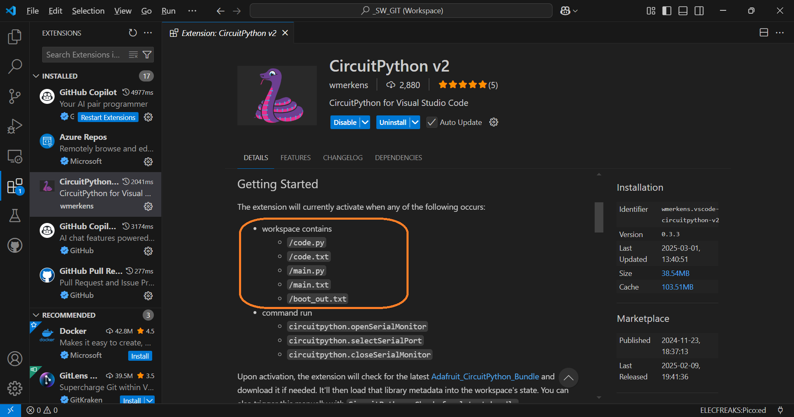
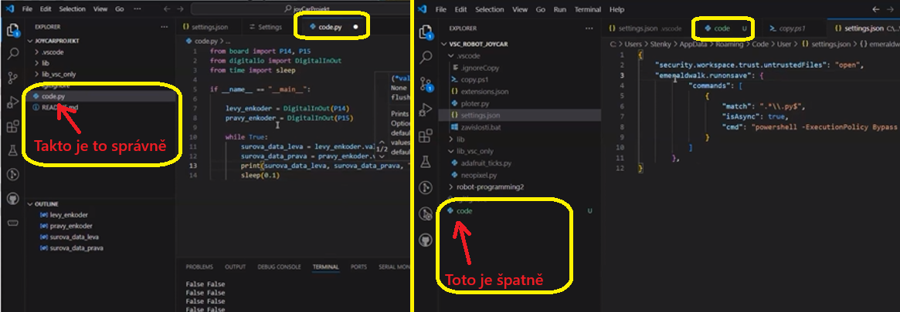

# 2. Nastavení Visual Studio Code pro použití s Pico:ed

Tento návod popisuje připojení desky **Pico:ed**, kontrolu a aktualizaci verze **CircuitPythonu**, nastavení automatického nahrávání kódu při uložení (`Run on Save`) a řešení běžných problémů.

> [!NOTE]
> Předpokládá se, že máte projekt otevřený ve VS Code a proběhl instalační skript `setup.bat` / `setup.sh` – viz [1. Instalace a nastavení VS Code, krok 4](1-instalace-vscode.md#4-otevření-projektu-ve-vs-code-a-rychlá-příprava-setupbat--setupsh).

---

## 1. Zlaté pravidlo kurzu: Python na PC nespouštíme!

> [!IMPORTANT]
> **Kód běží v hardware, nikoliv na vašem počítači.**  
> Kromě simulace a testů na PC (`.\cpy sim`, `.\cpy test` – slouží k vyzkoušení a ověření logiky bez robota, viz [Jak se testuje embedded kód](https://github.com/JanChaloupek/pomucky/blob/main/testovani-embedded-kodu.md)) v tomto kurzu **nespouštíte žádný `python.exe` na svém PC**.  
> Veškerý kód se automaticky odesílá do desky Pico:ed a spouští se přímo v jejím procesoru RP2040 pod systémem CircuitPython.  
> *(Python na PC sice nainstalovaný mít musíte, ale jen proto, že na něm běží nástroje projektu – nahrávání na desku, konzole, graf. Váš program pro robota na PC neběží.)*

---

## 2. Kontrola a aktualizace firmware CircuitPythonu

Připojte desku Pico:ed k počítači pomocí microUSB kabelu. V Průzkumníku souborů se musí objevit vyměnitelný disk s názvem **`CIRCUITPY`**.

### Jak zjistit verzi CircuitPythonu:
1. Otevřete disk `CIRCUITPY`.
2. Otevřete textový soubor **`boot_out.txt`**.
3. Na prvním řádku uvidíte nainstalovanou verzi, například:
   ```text
   Adafruit CircuitPython 9.2.1 on 2024-10-15; ELECFREAKS Pico:ed with rp2040
   ```
4. **Požadavek:** Pro správné fungování všech knihoven podvozku JoyCar a senzorů potřebujete **minimálně verzi 9** (aktuální stabilní verze je 10.x). Pokud máte starší verzi (např. CircuitPython 7.x nebo 8.x), musíte firmware aktualizovat!

---

### Jak aktualizovat firmware na verzi 9+ (krok za krokem):

1. **Odpojte USB kabel** Pico:edu od počítače.
2. Na zadní straně desky Pico:ed najděte malé bílé tlačítko označené **BOOTSEL**.
3. **Držte tlačítko BOOTSEL stisknuté** a zároveň zasuňte USB kabel do počítače. Po 2 sekundách tlačítko uvolněte.
4. Místo disku `CIRCUITPY` se v počítači objeví disk s názvem **`RPI-RP2`**.
5. Stáhněte si aktuální firmware CircuitPythonu (soubor s příponou `.uf2`) pro desku Pico:ed:
   - 🔗 [Oficiální stažení pro ELECFREAKS Pico:ed](https://circuitpython.org/board/elecfreaks_picoed/) (zvolte verzi 9.x nebo 10.x).
6. Stažený soubor `.uf2` jednoduše **přetáhněte myší (nakopírujte) na disk `RPI-RP2`**.
7. Deska po dokončení zápisu okamžitě sama restartuje a v systému se znovu přihlásí jako disk **`CIRCUITPY`**.
8. Znovu otevřete `boot_out.txt` a ověřte, že je verze 9+.

---

## 3. Konfigurace rozšíření CircuitPython ve VS Code

1. Otevřete v projektu soubor `code.py`. Tím se aktivuje rozšíření **CircuitPython v2 Cursor AI** (verze 0.3.3).
2. Podívejte se do **dolní modré stavové lišty** (Status Bar). Pokud v ní místo desky vidíte `<Choose a board>`, klikněte na ni, do vyhledávacího políčka v horní části napište **`picoed`** a vyberte:  
   `ELECFREAKS:Pico:ed`
3. Tím se stáhnou typové definice specifické pro Pico:ed a editor začne správně napovídat piny a moduly.

| Aktivace rozšíření v dolní stavové liště | Pozor na příponu `code.py` ve Windows |
| :---: | :---: |
|  |  |
| *Výběr desky Pico:ed na stavové liště* | *Vlevo špatně (`code.py.txt`), vpravo správně (`code.py`)* |

Nápovědu (IntelliSense) navíc zajišťují typové definice ve složce `pc/_stubs` – nastavení pro ně v `.vscode/settings.json` je součástí projektu. VS Code proto nabízí bezchybnou nápovědu pro moduly desky Pico:ed (`board`, `busio`, `digitalio`, `picoed`, `neopixel` atd.) a nepodtrhává importy červeně jako chybu.

---

## 4. Automatické nahrávání kódu při uložení (`Run on Save`)

Při každém stisku `Ctrl+S` ve VS Code rozšíření **Run on Save** automaticky spustí příkaz **`cpy save`** (nástroj `.vscode/deska.py`). Ten:
1. zkontroluje v souboru `.vscode/.ignoreCopy`, jestli se uložený soubor na desku vůbec kopíruje,
2. najde připojený disk `CIRCUITPY` (ve Windows písmeno disku, na macOS `/Volumes/CIRCUITPY`, na Linuxu `/media/$USER/CIRCUITPY` apod.),
3. porovná soubor s tím, co už na desce je,
4. a pokud se liší, zkopíruje ho. **CircuitPython pak sám spustí nový kód** (tzv. *autoreload*).

Run on Save reaguje na soubory `.py`, `.toml`, `.json`, `.txt` a `.csv`. Příkaz je stejný ve Windows, Linuxu i macOS.

> [!TIP]
> **Po spuštění `setup.bat` / `./setup.sh` je vše plně nastaveno!**  
> Rozšíření `Run on Save` je nainstalované a konfigurace v `.vscode/settings.json` je připravená. **Nemusíte nic ručně konfigurovat.** Stačí otevřít soubor `code.py`, stisknout `Ctrl+S` a kód se okamžitě odešle do desky Pico:ed.  
> V souboru `.vscode/.ignoreCopy` je navíc zapsán soubor `main.py`, takže automatické ukládání CircuitPythonu nijak nekoliduje s případnou prací v MicroPythonu.

Jak je `Run on Save` nastavené (příkaz v `.vscode/settings.json`), popisuje pro zvědavé soubor **`docs/Nastroje.md`** v projektu. Na Linuxu a macOS musí příkaz začínat `python3` – to zařídí `./setup.sh`.

### Tlačítka v panelu (blok CircuitPython)

Rozšíření **MicroPython & CircuitPython Panel** (ikona čipu v levém svislém pruhu) má blok **CircuitPython**. Ukazuje připojenou desku (port, disk, verzi firmwaru) a nabízí čtyři tlačítka:

| Tlačítko | Co udělá | Totéž v terminálu |
|---|---|---|
| **⬆ Nahrát projekt** | nahraje celý projekt na disk `CIRCUITPY` (jen změněné soubory, podle `.ignoreCopy`) | `.\cpy upload` |
| **↻ Restartovat program** | znovu spustí `code.py` a ukáže jeho první výstup | `.\cpy reset` |
| **⌨ Konzole (REPL)** | otevře sériovou konzoli desky (viz [kapitola 6](#6-sériová-konzole-repl)) | `.\cpy repl` |
| **🗑 Smazat desku** | smaže obsah disku `CIRCUITPY` – VS Code se nejdřív zeptá | `.\cpy wipe` |

Třetí blok **Na PC bez desky** má tlačítka **▶ Simulace code.py** (`cpy sim`), **✓ Testy code.py** (`cpy test`), **▶ Simulace main.py** (`mpy sim`) a **✓ Testy main.py** (`mpy test`). Desku nepotřebuje, a proto se nikdy neztlumí. Viz [Simulace a testy bez robota](#-simulace-a-testy-bez-robota-cpy-sim-cpy-test).

Na Linuxu a macOS se v terminálu píše `./cpy.sh` místo `.\cpy`. Přehled všech příkazů vypíše `.\cpy help`. Podrobný popis najdete v souboru **`docs/CircuitPython.md`** přímo v projektu.

> [!NOTE]
> **Původ a autorství:**
> Automatické nahrávání dříve zajišťovaly samostatné skripty. Skript **`copy.ps1`** pro Windows napsal lektor a mentor kurzu **Jan Chaloupek**. Skript **`copy.sh`** pro macOS a Linux původně vytvořil student kurzu **Robin Bortlík** (@Robin Bortlik) v předchozích ročnících a Jan Chaloupek jej následně upravil a začlenil do standardní výbavy kurzu. Jejich postup dnes převzal společný nástroj `deska.py` (příkaz `cpy save`), který funguje stejně na všech systémech.

### 💡 Simulace a testy bez robota (`cpy sim`, `cpy test`)

Pokud zrovna nemáte desku Pico:ed u sebe (např. na cestách), můžete program vyzkoušet na PC. Projekt má ve složce **`pc/_fake`** falešné verze modulů desky (`board`, `picoed`, `digitalio`, `pwmio`, `neopixel`, `time`, …):

| Příkaz | Co dělá |
|---|---|
| **`.\cpy sim`** (tlačítko **▶ Simulace code.py**) | spustí `code.py` na PC; konzole vypisuje, co by dělala LED, displej a bzučák (`[ 1.00 s] LED: ZAPNUTO (*)`). Klávesy `a` / `b` stisknou tlačítko A / B, `q` simulaci ukončí. |
| **`.\cpy test`** (tlačítko **✓ Testy code.py**) | spustí unit testy ze složky `pc/tests` – ověří, že program s hardwarem dělá, co má. |

Pro MicroPython (`main.py`) jsou stejné příkazy `.\mpy sim` a `.\mpy test` (tlačítka **▶ Simulace main.py** a **✓ Testy main.py**), viz [kapitola 3](3-microbit-a-micropython.md).

Simulace i testy používají stejný falešný hardware. Všechno ve složce `pc/` běží jen na počítači a díky `.vscode/.ignoreCopy` se nikdy nenahraje na robota. Jak se testy píšou, popisuje [Jak se testuje embedded kód](https://github.com/JanChaloupek/pomucky/blob/main/testovani-embedded-kodu.md).

---

## 5. 💡 Co dělat, když se soubory neukládají na Pico:ed

Pokud po uložení (`Ctrl+S`) kód na robotovi nereaguje, postupujte podle této diagnostiky:

### Krok 1: Kontrola chyb v okně OUTPUT
1. Ve VS Code otevřete okno **OUTPUT** pomocí zkratky `Ctrl+Shift+U` (nebo přes horní menu: *View → Output*).
2. V pravé části okna OUTPUT přepněte rozbalovací filtr na **`Run On Save`**.
3. Přepněte se zpět do `code.py` a stiskněte **`Ctrl+S`**.
4. V okně OUTPUT se okamžitě zobrazí výpis po očíslovaných krocích:
   ```text
   Run on Save: kopirovani ulozeneho souboru na desku CIRCUITPY (09:22:58)
   1) Ulozeny soubor          - jaký soubor, jeho velikost a čas uložení
   2) Pravidla                - jestli ho .ignoreCopy nevylučuje (a kterou maskou)
   3) Disk desky CIRCUITPY    - kde je disk, volné místo, verze firmwaru
   4) Cil na desce            - co tam teď je a jestli se obsah liší
   5) Kopirovani              - výsledek zápisu
   Hotovo: code.py -> F:\code.py. CircuitPython program sam restartuje (autoreload).
   ```
   Když se něco nepovede, výpis skončí červeným řádkem `ERROR: v kroku N - …` s radou, co dělat (např. `v kroku 3 - disk CIRCUITPY nenalezen`). Stejný výpis dostanete i ručně v terminálu příkazem `.\cpy save code.py`.
5. **Okno OUTPUT pro *Run On Save* je prázdné?** Run on Save se vůbec nespustil. Zkontrolujte, že je nainstalované rozšíření *Run on Save* a že má soubor příponu `.py`, `.toml`, `.json`, `.txt` nebo `.csv`.
6. **Linux / macOS – chyba `python: command not found`?** Nespustili jste `./setup.sh`, viz [kapitola 1, krok 4](1-instalace-vscode.md#4-otevření-projektu-ve-vs-code-a-rychlá-příprava-setupbat--setupsh).

### Krok 2: Zamčený disk (Read-only ve Windows)
Velmi častou příčinou je, že operační systém Windows disk `CIRCUITPY` zamkne proti zápisu kvůli náhlému odpojení nebo přepětí:
- **První pomoc:** Odpojte USB kabel od počítače a po 3 sekundách jej znovu zapojte – disk se ve Windows znovu načte.
- **Pokud to nepomůže – ÚPLNÝ RESTART ROBOTA (Power-Cycle):**
  1. Odpojte USB kabel od počítače.
  2. Vypněte hlavní napájecí přepínač na základní desce JoyCaru.
  3. Znovu zapněte napájení JoyCaru.
  4. Zapojte USB kabel zpět do počítače.

---

## 6. Sériová konzole (REPL)

REPL (Read-Eval-Print Loop) umožňuje sledovat textové výstupy `print()`, zprávy z `log` i chybové výjimky přímo z jedoucího robota:

1. Klikněte v dolní liště VS Code na ikonu **zástrčky sériového portu** (CircuitPython).
2. Vyberte COM port odpovídající vašemu Pico:ed.
3. V terminálu se otevře interaktivní okno CircuitPythonu.
4. **Ovládání:**
   - `Ctrl+C` : Zastaví právě běžící program v robotovi a přejde do příkazového řádku REPL.
   - `Ctrl+D` : Soft reset – znovu spustí program `code.py` od začátku.

**Druhá možnost:** tlačítko **⌨ Konzole (REPL)** v bloku CircuitPython v panelu, nebo příkaz `.\cpy repl` v terminálu (Linux/macOS: `./cpy.sh repl`). Port najde sám a konzoli ukončíte klávesami `Ctrl+]`.

> [!NOTE]
> Sériový port může mít otevřený vždy jen **jeden program**. Pokud konzole hlásí, že port nelze otevřít, zavřete druhou konzoli (zástrčku v dolní liště, Serial Monitor, Thonny, Mu). Nahrávání po `Ctrl+S` a tlačítko **⬆ Nahrát projekt** sériový port nepoužívají, takže fungují i při otevřené konzoli.

---

## 7. 🛠️ Tip: Práce ve VS Code Workspace (více složek najednou)

Pokud chcete mít v levém průzkumníku VS Code zobrazený jak svůj pracovní projekt z disku počítače, tak přímo obsah disku `CIRCUITPY` v robotovi:

1. Otevřete svůj pracovní projekt jako obvykle (`File → Open Folder...`).
2. V horním menu zvolte **File** → **Add Folder to Workspace...**
3. Vyberte připojený disk `CIRCUITPY`.
4. V levém panelu nyní uvidíte obě složky pod sebou.
5. Aby se toto nastavení uchovalo i po restartu VS Code, uložte si ho:  
   **File** → **Save Workspace As...** (např. pod názvem `joyCar.code-workspace`).  
   Příště pak otevíráte přímo tento soubor workspace.

---

### Kam pokračovat dál?

- **Pokud v kurzu začínáte úvodním srovnávacím cvičením s BBC micro:bitem:**  
  👉 **[3. Úvodní práce s Micro:bitem a MicroPythonem](3-microbit-a-micropython.md)**
- **Pokud pokračujete přímo v hlavní lince kurzu s robotem JoyCar:**  
  👉 **[4. Práce s Git a GitHubem (Odevzdávání úkolů)](4-prace-s-gitem.md)**
