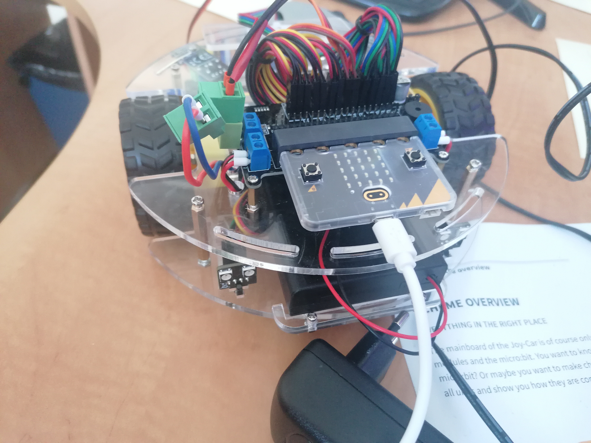

# 3. Úvodní práce s Micro:bitem a MicroPythonem (Mu Editor a VS Code)

Tato kapitola je **samostatná a informativní**. Slouží pro úvodní cvičení na začátku kurzu, kde si vyzkoušíme desku **BBC micro:bit v2** a ukážeme si rozdíl mezi **MicroPythonem** a **CircuitPythonem**.

V kurzu máte pro MicroPython k dispozici **dvě cesty**:
1. **Jednoduchá cesta pro začátečníky:** Oficiální **Mu Editor** (vhodné pro okamžité seznámení s BBC micro:bitem bez nastavování).
2. **Pokročilá cesta ve VS Code:** Využití připravených skriptů a rozšíření přímo v našem výchozím projektu kurzu (podpora pro BBC micro:bit i Pico:ed s MicroPython firmwarem).

---

## 1. Proč na začátku zkoušíme Micro:bit a MicroPython?

- **Rychlý start bez složité konfigurace:** BBC micro:bit s editorem Mu funguje okamžitě po zapojení bez nutnosti instalovat Python, kompilátory či složité pluginy.
- **Rozdíl v architektuře firmware:**
  - **BBC micro:bit (MicroPython):** Kód se do desky nahrává flashováním nebo sériovým přenosem (přes `mpremote` či WebUSB). V počítači nevzniká virtuální flash disk typu `CIRCUITPY`.
  - **Pico:ed (CircuitPython):** Kód se nahrává jako běžné soubory na USB disk `CIRCUITPY`. Robot nabízí výrazně větší výkon procesoru RP2040 (dvoujádrový ARM Cortex-M0+ na 133 MHz) a bohaté možnosti pro řízení motorů a senzorů JoyCaru.



---

## 2. Varianta A: Stažení a práce s Mu Editorem (Pro micro:bit)

> [!NOTE]
> **Je pro spuštění Mu Editoru potřeba mít nainstalovaný Python a pip?**  
> **Není!** Oficiální instalátor z [codewith.mu](https://codewith.mu/) pro Windows (`.exe`) i macOS (`.pkg`) je plně samostatná aplikace (standalone bundle), která má svůj vlastní Python runtime i všechny potřebné knihovny zabalené přímo v sobě. Student tedy nemusí instalovat Python, pip ani nic konfigurovat v příkazové řádce – stačí stáhnout a spustit instalátor.  
> *(Instalace přes `pip install mu-editor` se používá volitelně pouze na Linuxu nebo u pokročilých uživatelů, kteří chtějí provozovat Mu ve svém vlastním virtuálním prostředí).*

1. Navštivte oficiální stránky editoru: **[codewith.mu](https://codewith.mu/)**.
2. V sekci **Download** stáhněte instalátor pro váš operační systém (**Windows**, **macOS** nebo **Linux**).
3. Spusťte instalaci a otevřete program **Mu**.
4. Vlevo nahoře klikněte na tlačítko **Mode** (Režim), vyberte **BBC micro:bit** a potvrďte **OK**.
5. Vložte jednoduchý ukázkový kód:
   ```python
   from microbit import *

   display.scroll("ZSaPR")

   while True:
       if button_a.is_pressed():
           display.show(Image.HAPPY)
       elif button_b.is_pressed():
           display.show(Image.SAD)
       else:
           display.clear()
   ```
6. Připojte micro:bit USB kabelem a klikněte na tlačítko **Flash** na horní liště.
   - Žlutá LED dioda na zadní straně se rychle rozbliká.
   - Program se nahraje a deska začne rolovat text na svém 5×5 LED displeji.
7. **REPL a Plotter v Mu Editoru:**
   - **Tlačítko REPL:** Otevře interaktivní konzoli MicroPythonu pro ladění a výpisy z `print()`.
   - **Tlačítko Plotter:** Pokud do konzole vypisujete dvojice čísel, Mu z nich automaticky v reálném čase kreslí graf.

---

## 3. Varianta B: MicroPython přímo ve Visual Studio Code

Pokud nechcete přepínat mezi různými editory a chcete MicroPython používat přímo v profesionálním prostředí **Visual Studio Code**, máme v našem výchozím repozitáři projektu připravenou kompletní infrastrukturu skriptů i vlastní rozšíření pro VS Code.

### Co je v projektu pro MicroPython připraveno:

1. **Příprava prostředí:** instalační skript `setup.bat` / `./setup.sh` z [1. Instalace a nastavení VS Code, krok 4](1-instalace-vscode.md#4-otevření-projektu-ve-vs-code-a-rychlá-příprava-setupbat--setupsh) nainstaluje i vše pro MicroPython – nástroj **`mpremote`** (komunikace s deskou přes sériový port) a panel s tlačítky.

2. **Rozšíření MicroPython & CircuitPython Panel:**
   - V levém svislém pruhu přidá ikonu čipu. Postranní panel má blok **MicroPython** a blok **CircuitPython**. Každý blok ukazuje připojenou desku (obnovuje se sám) a nejčastější akce. Blok, pro který není připojená deska, je ztlumený.
   - Tlačítka bloku **MicroPython**:

     | Tlačítko | Co udělá | Totéž v terminálu |
     |---|---|---|
     | 🟨 **⬆ Nahrát projekt** | podle `.vscode/upload_config.txt` nahraje na desku soubory (např. `main.py` a složku `lib`); nezměněné soubory přeskočí | `.\mpy upload` |
     | 🟩 **▶ Spustit main.py** | restartuje desku, spustí `main.py` a ukáže jeho první výstup | `.\mpy reset` |
     | 🟦 **⌨ Konzole (REPL)** | otevře interaktivní konzoli MicroPythonu (konec: `Ctrl+]`) | `.\mpy repl` |
     | 🟥 **🗑 Smazat desku** | po potvrzení smaže všechny soubory z desky pro čistý začátek | `.\mpy wipe` |

   - **Nahrát projekt** a **Konzole** jsou i ve spodním stavovém řádku (`MPY Upload`, `MPY REPL`).
   - Na rozdíl od CircuitPythonu MicroPython po nahrání program **sám nespustí** – po nahrání klikněte na **▶ Spustit main.py**.
   - Všechno ostatní (výpis souborů na desce, graf hodnot, diagnostika) je v terminálu: `.\mpy help` (Linux/macOS: `./mpy.sh help`). Podrobný popis najdete v souboru **`docs/MicroPython.md`** přímo v projektu.
   - Každý příkaz vypisuje průběh po očíslovaných krocích. Když se něco nepovede, skončí řádkem `ERROR: v kroku N - …` s radou, co dělat (např. že port drží jiný program).
   - Obě technologie (MicroPython a CircuitPython) v projektu harmonicky koexistují – automatické ukládání `Run on Save` pro CircuitPython soubor `main.py` ignoruje, takže se můžete kdykoli bez kolize přepnout mezi psaním pro CircuitPython (`code.py`) a MicroPython (`main.py`).

3. **Knihovna hardware pro Pico:ed (`lib/picoed_v2_lib`):**
   - Pokud provozujete desku Pico:ed s MicroPython firmwarem, máte v adresáři `lib/picoed_v2_lib` k dispozici hotové ovladače:
     - `display.py` a `is31fl3731.py` pro LED maticový displej 7×17,
     - `button.py` pro tlačítka A a B,
     - `led.py` pro stavové LED,
     - `music.py` pro neblokující bzučák,
     - `ultrasonic.py` pro měření vzdálenosti.

4. **Typová nápověda Pylance (`pc/_stubs`):**
   - Ve složce `pc/_stubs` jsou připraveny soubory `machine.pyi` a `rp2.pyi`, takže Pylance ve VS Code nepodtrhává importy a nabízí plnohodnotné automatické doplňování kódu a parametrů pro mikrokontrolér RP2040.

5. **Simulace a testy bez desky:**
   - **`.\mpy sim`** (v panelu **▶ Simulace main.py**) spustí `main.py` na PC. Falešný modul `machine` simuluje Pico:ed v2 a konzole vypisuje, co by dělala LED, displej a bzučák. Klávesy `a` / `b` stisknou tlačítko A / B, `q` simulaci ukončí.
   - **`.\mpy test`** (v panelu **✓ Testy main.py**) spustí unit testy ze složky `pc/tests_mpy`.
   - Podrobnosti najdete v souboru **`docs/MicroPython.md`** (kapitola 8).

---

## 4. Shrnutí a přechod k hlavnímu robotovi JoyCar

Vyzkoušeli jste si základní principy běhu MicroPythonu. Pro stavbu a programování našeho hlavního autonomního robota JoyCar však v dalších kapitolách budeme primárně využívat **CircuitPython na desce Pico:ed v2** pro jeho vynikající podporu knihoven, práci přes USB disk `CIRCUITPY` a přehledné řízení periferií.

👉 **Pokračujte na: [4. Práce s Git a GitHubem (Odevzdávání úkolů)](4-prace-s-gitem.md)**
