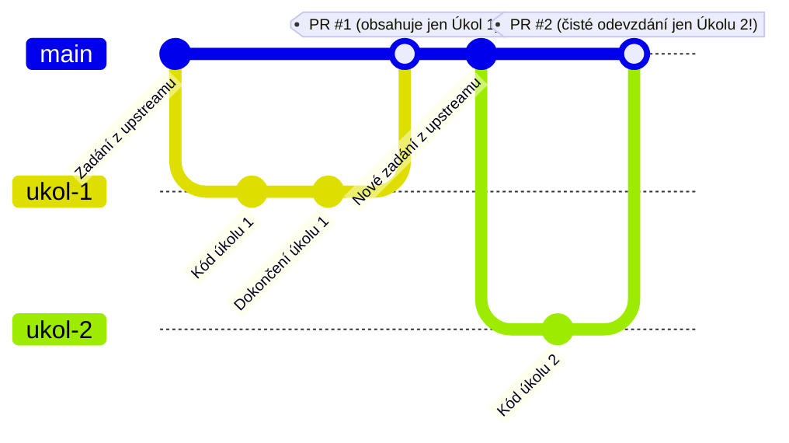

# 4. Práce s Git a GitHubem – Odevzdávání úkolů přes Pull Requesty

V tomto kurzu se naučíte pracovat s verzovacím systémem **Git** a platformou **GitHub** způsobem, který se běžně používá v profesionálních softwarových týmech.

Všechny úkoly kurzu se budou odevzdávat formou **Pull Requestu (PR)** do oficiálního repozitáře kurzu (podobně jako v [minulých ročnících kurzu](https://github.com/Global-Classes-CZE/robotprogramming/pulls?q=is%3Apr+state%3Aclosed)).

Tento návod vám ukáže, jak vše nastavit a jak se vyhnout nejčastější chybě studentů: **míchání starých úkolů do nových odevzdání**.

---

## 1. Jak funguje model dvou repozitářů (Upstream vs. Origin)

Do oficiálního školního repozitáře **nemáte přímé právo zápisu** (nemůžete tam dělat `git push`). Proto se používá model **Fork & Pull Request**:

```
Centrální repozitář kurzu (UPSTREAM)
        │
        │ 1. Fork na webu GitHubu
        ▼
Váš osobní repozitář na GitHubu (ORIGIN)
        ▲                                │
        │ 4. git push origin ukol-1      │ 2. git clone
        │                                ▼
    Váš počítač (Lokální pracovní složka v VS Code)
```

1. **`upstream`** = Oficiální repozitář kurzu. Odtud si stahujete nová zadání, opravy a knihovny.
2. **`origin`** = Váš osobní repozitář na GitHubu (váš **Fork**). Zde máte plná práva a sem posíláte své vypracované úkoly.

---

## 2. Úvodní nastavení (dělá se jen jednou na začátku kurzu)

### Krok 1: Vytvoření forku na GitHubu
1. Přihlaste se na [github.com](https://github.com).
2. Otevřete odkaz na oficiální repozitář kurzu zadaný vyučujícím.
3. V pravém horním rohu klikněte na tlačítko **Fork**.
4. Ponechte výchozí nastavení a klikněte na **Create fork**.
5. Na vašem profilu vznikne vaše vlastní kopie repozitáře.

### Krok 2: Naklonování vašeho forku do počítače
1. Na stránce vašeho forku klikněte na zelené tlačítko **<> Code** a zkopírujte URL adresu (např. `https://github.com/vase-jmeno/robot-programming3.git`).
2. Otevřete terminál (nebo VS Code: `Ctrl+Shift+P` → *Git: Clone*).
3. Spusťte příkaz pro naklonování:
   ```bash
   git clone https://github.com/vase-jmeno/robot-programming3.git
   cd robot-programming3
   ```

### Krok 3: Nastavení propojení na oficiální repozitář (`upstream`)
Ve složce projektu nastavíme odkaz na původní školní repozitář, abychom z něj mohli stahovat aktualizace:
```bash
git remote add upstream https://github.com/Global-Classes-CZE/robot-programming3.git
```
Ověřte nastavení příkazem:
```bash
git remote -v
```
Měli byste vidět:
- `origin` ukazuje na vaše osobní URL.
- `upstream` ukazuje na oficiální školní URL.

### Krok 4: Rychlá příprava prostředí (`setup.bat`)
Před začátkem psaní kódu spusťte ve složce projektu soubor **`setup.bat`** (ve Windows na něj stačí dvakrát kliknout v Průzkumníkovi nebo spustit `.\setup.bat` v terminálu).  
Tento skript za vás plně automaticky nainstaluje všechna potřebná rozšíření do VS Code, nastaví komunikaci i automatické nahrávání kódu při stisku `Ctrl+S` (`Run on Save`).

---

## 3. Zlaté pravidlo: Jeden úkol = Jedna samostatná větev

> [!CAUTION]
> **Nejčastější chyba studentů z minulých let:**  
> Pokud student pracuje stále na větvi `main`, nebo větev pro *Úkol 2* založí z větve *Úkol 1*, stane se, že **nový Pull Request obsahuje všechny staré úkoly z minulých týdnů**! Vyučující pak nemůže úkol přehledně zhodnotit.

Řešení je velmi jednoduché a má přesná pravidla:
1. **Na větvi `main` se kód nikdy přímo neupravuje.** Větev `main` slouží jen jako čisté zrcadlo školního repozitáře.
2. **Před každým novým úkolem se `main` zaktualizuje z `upstreamu`.**
3. **Každý úkol se vypracovává v nové vlastní větvi** (např. `ukol-1`, `ukol-2`).



---

## 4. Pracovní postup krok za krokem (při každém úkolu)

### Fáze 1: Synchronizace větve `main` (před začátkem práce)
Před zahájením nového úkolu si stáhněte nejnovější stav z oficiálního repozitáře kurzu:

```bash
# 1. Přepněte se do větve main
git checkout main

# 2. Stáhněte nejnovější změny z oficiálního repozitáře
git pull upstream main

# 3. Zaktualizujte také svůj GitHub fork
git push origin main
```

---

### Fáze 2: Založení nové větve pro daný úkol
Nyní vytvořte novou větev. Větev pojmenujte jasně podle čísla úkolu (např. `ukol-1`):

```bash
git checkout -b ukol-1
```
*(Tento příkaz vytvoří větev `ukol-1` a rovnou vás do ní přepne).*

Ve VS Code můžete větev vytvořit také kliknutím na název aktuální větve v levém dolním rohu stavového řádku a volbou *Create new branch...*.

---

### Fáze 3: Vypracování úkolu a uložení (commit)
Nyní pracujete na svém kódu v Pico:ed. Jakmile máte úkol hotový a otestovaný:

```bash
# Zkontrolujte změněné soubory
git status

# Přidejte změněné soubory do commitu
git add .

# Vytvořte commit s výstižnou zprávou
git commit -m "Vypracování úkolu 1: line-following robot"
```

---

### Fáze 4: Odeslání větve na váš GitHub
Odešlete svou novou větev do svého osobního forku na GitHubu:

```bash
git push origin ukol-1
```

---

### Fáze 5: Vytvoření Pull Requestu pro vyučujícího

1. Otevřete v prohlížeči stránku svého forku na GitHubu (`https://github.com/vase-jmeno/robot-programming3`).
2. Nahoře se automaticky objeví žlutý proužek:  
   **`ukol-1 had recent pushes less than a minute ago`** s tlačítkem **Compare & pull request**. Klikněte na něj.
3. **Velmi důležitá kontrola záhlaví (směr PR):**
   - **Base repository:** `Global-Classes-CZE/robot-programming3` | **base:** `main` *(cílový školní repozitář)*
   - **Head repository:** `vase-jmeno/robot-programming3` | **compare:** `ukol-1` *(vaše větev)*
4. **Název Pull Requestu:** Zadejte přesný formát:  
   **`<Jméno> <Příjmení> <duXX>`**  
   *(Například: `Jan Chaloupek du5` nebo `Petr Novák du1`)*  
   
   > [!IMPORTANT]
   > Jméno a příjmení musí **přesně odpovídat jménu, pod kterým jste přihlášeni do kurzu v Google Classroom** a které používáte na Discord serveru kurzu (pokud máte na Discordu jinou přezdívku, upravte si ji pro náš server podle návodu v úvodu).  
   > Dodržení tohoto formátu je povinné – slouží vyučujícím k rychlému spárování úkolu a zapsání bodů v Classroom.
5. **Popis řešení a přiložení snapshotu kódu (doporučeno):**  
   Do textového pole popisu uveďte stručné shrnutí vašeho řešení.
   
   > [!TIP]
   > **Vložení ukázky klíčového kódu (CodeSnap-plus-fix) – usnadní a urychlí hodnocení vyučujícímu:**  
   > U složitějších domácích úloh je skvělou a osvědčenou praxí přiložit do popisu Pull Requestu obrázek (snapshot) stěžejní části kódu, která řeší jádro zadání (např. řídicí podmínku, stavový automat nebo regulátor). Vyučující tak okamžitě „na první dobrou“ vidí vaši myšlenku bez nutnosti okamžitě listovat celým diffem.  
   > 
   > **Jak snapshot vytvořit během pár sekund přes rozšíření CodeSnap-plus-fix:**
   > 1. Ve VS Code označte myší stěžejní blok kódu.
   > 2. Klikněte pravým tlačítkem myši a zvolte **CodeSnap-plus-fix** (nebo stiskněte `Ctrl+Shift+P` a vyhledejte *CodeSnap-plus-fix*).
   > 3. V otevřeném náhledu můžete kliknutím na čísla řádků barevně zvýraznit nejdůležitější řádky kódu (cykluje režimy Focus / Git-Add / Git-Remove).
   > 4. Klikněte do náhledu a stiskněte **`Ctrl+C`** (zkopírovat do schránky), případně klikněte na ikonku spouště pro uložení PNG.
   > 5. Přejděte na stránku nového Pull Requestu na GitHubu a v poli pro text popisu stiskněte **`Ctrl+V`**. GitHub obrázek automaticky nahraje a zobrazí!
6. **Klíčová sebekontrola:** Klikněte dole na záložku **Files changed** (Změněné soubory).
   - > [!TIP]
     > Pokud jste postupovali správně, uvidíte zde **POUZE a JEDINĚ soubory patřící k Úkolu 1**! Žádné staré soubory ani konflikty.
7. Klikněte na zelené tlačítko **Create pull request**. Úkol je úspěšně odevzdán!

---

## 5. Co dělat, když vyučující napíše připomínky k PR?

Pokud vám vyučující v Pull Requestu napíše komentář, že je potřeba něco opravit:
1. **Nezakládejte nový Pull Request!**
2. Zůstaňte v téže větvi na svém počítači:
   ```bash
   git checkout ukol-1
   ```
3. Proveďte požadované opravy v kódu.
4. Změny commitněte a odešlete:
   ```bash
   git add .
   git commit -m "Oprava připomínek vyučujícího"
   git push origin ukol-1
   ```
5. Váš stávající Pull Request na GitHubu se **automaticky sám aktualizuje** o nový commit.

---

## 6. Jak začít další úkol (Úkol 2)?

Až bude zadán další úkol (např. *Úkol 2*), zopakujete celý cyklus:
1. `git checkout main`
2. `git pull upstream main`
3. `git push origin main`
4. `git checkout -b ukol-2`
5. Programujete, commitujete a posíláte PR z větve `ukol-2`.

Díky tomuto postupu budete mít každé odevzdání naprosto čisté, přehledné a bez zbytečných chyb!

---

## 7. Doporučené externí materiály k samostudiu Gitu

Pokud s Gitem teprve začínáte nebo si chcete ujasnit vizuální práci s verzováním přímo ve VS Code:
- 🎥 **Video průvodce:** [Jak na Git a Git-Hub ve Visual Studio Code (YouTube video pro začátečníky)](https://www.youtube.com/watch?v=0v5K4GvK4Gs)
- 📖 **Přehled příkazů:** [14 Git příkazů, které musí znát každý vývojář (Skillmea blog)](https://skillmea.cz/blog/14-git-prikazu-ktere-musi-znat-kazdy-vyvojar)

---

### Kam pokračovat dál?

- **Krok 4 – programování pohybu robota:**  
  👉 **[5. Ovládání motorů robota JoyCar](5-ovladani-motoru.md)** – bezpečné řízení motorů a prevence odpálení můstku.
- **Příprava dráhy a mapy pro jízdu robota:**  
  👉 **[6. Praktické tipy, mapy a vylepšení výbavy](6-tipy-vybaveni-a-mapy.md)** – návod na výrobu testovací dráhy (páska na lino, dlaždice A4, PDF mapy).
