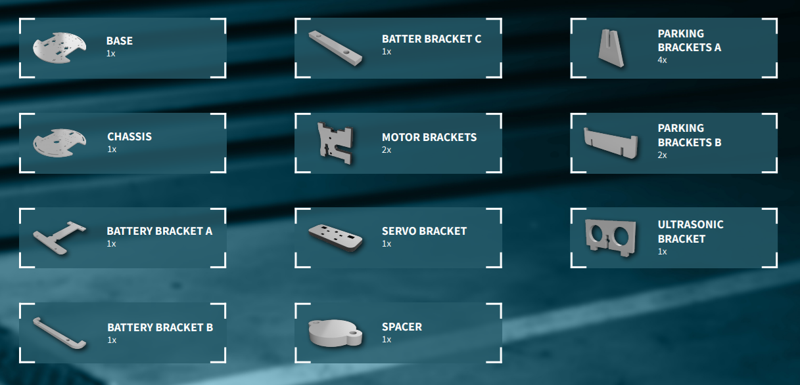
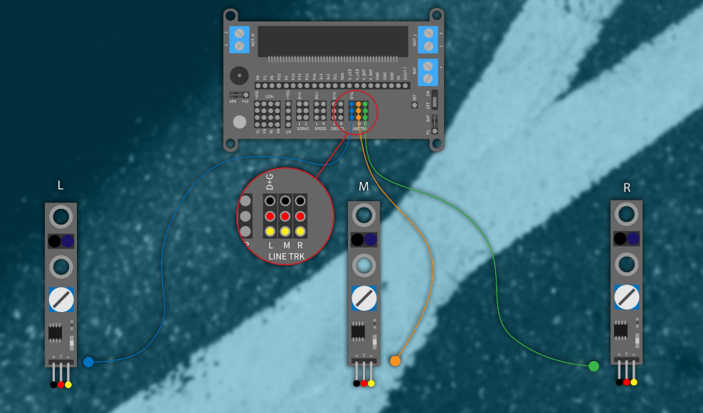
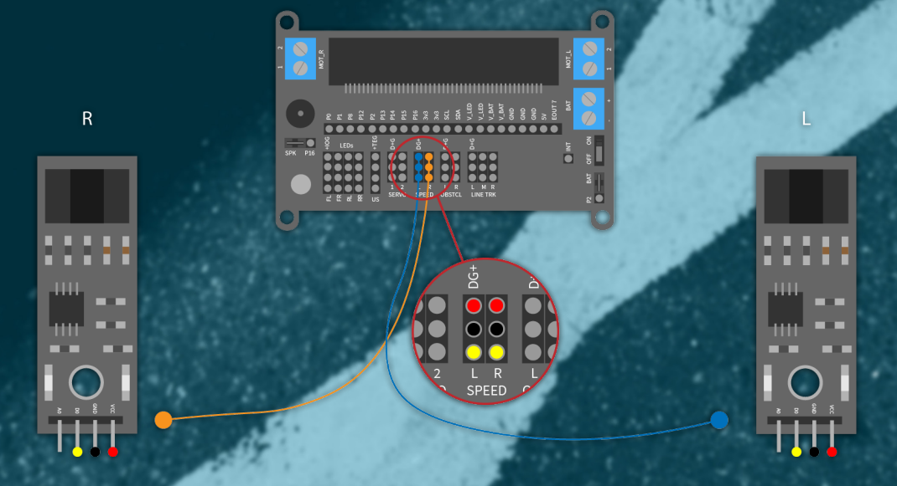
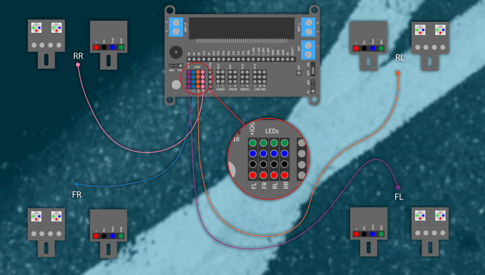
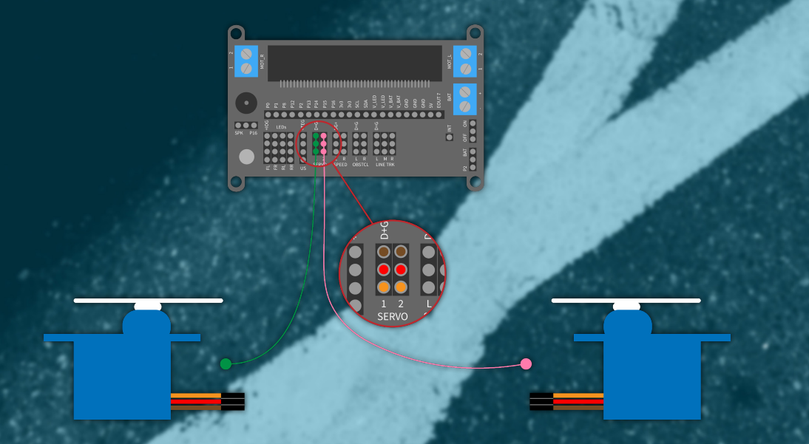
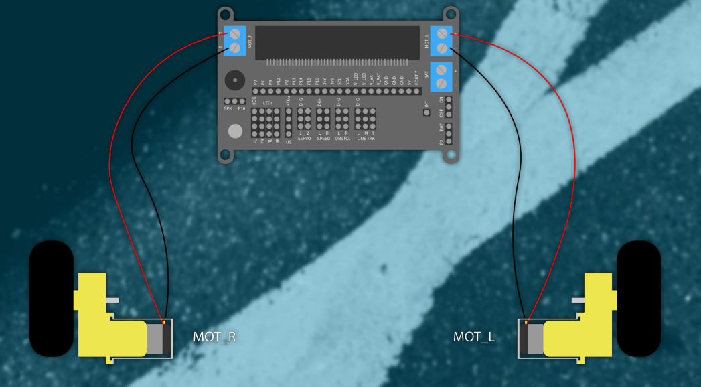
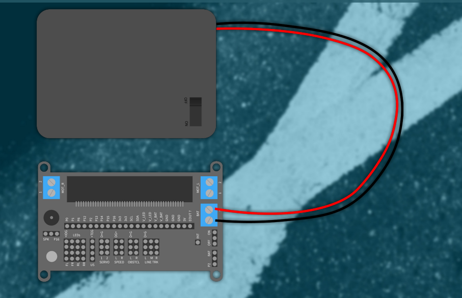

# 5. Mechanická montáž a zapojení robota JoyCar

V této kapitole si krok za krokem sestavíte samotného robota **JoyCar** – od mechanické montáže podvozku a motorů, přes osazení senzorů, až po správné zapojení veškeré kabeláže k základní desce.

  
   
  <em>Kompletně sestavený robot JoyCar s deskou, senzory a LED osvětlením</em>

---

## 1. Obsah balení a kontrola dílů

Před zahájením montáže doporučujeme vybalit a zkontrolovat všechny součástky stavebnice.

### A. Elektronické moduly a senzory:

| Součástka | Počet | Popis a funkce v robotovi |
| :--- | :---: | :--- |
| **Základní deska (Mainboard)** | 1× | Řídicí deska se slotem pro Pico:ed / micro:bit, budičem motorů PCA9633 a I²C expandérem |
| **Senzor sledování čáry (Line Tracking)** | 3× | Infračervené reflexní snímače podvozku pro detekci černé čáry (L, M, R) |
| **Senzor překážek (Obstacle Sensor)** | 2× | Infračervené snímače přiblížení pro detekci překážek před robotem |
| **Snímač rychlosti (Speed Sensor)** | 2× | Optické štěrbinové snímače (optozávory) pro odměřování otáček motorů (enkodéry) |
| **LED světelný modul** | 4× | RGB LED moduly světlometů a blinkrů (přední FL, FR a zadní RL, RR) |
| **Ultrazvukový senzor (HC-SR04)** | 1× | Snímač vzdálenosti pro bezkontaktní měření objektů |
| **Servomotor (SG90)** | 2× | Mikroserva pro natáčení ultrazvukového snímače (případně další mechanismy) |
| **Stejnosměrný motor TT s převodovkou** | 2× | Pohonné motory kol se dvěma výstupními hřídelemi (vnější pro kolo, vnitřní pro enkodér) |
| **Bateriové pouzdro** | 1× | Pouzdro pro 4× AA baterie s vypínačem a vývodem vodičů |
| **Sada 3pinových DuPont kabelů** | 7× | Kabely pro senzory čáry, překážek a rychlosti |
| **Sada 4pinových DuPont kabelů** | 5× | Kabely pro 4 LED světelné moduly a ultrazvukový senzor |

---

### B. Akrylové a mechanické díly podvozku:

| Díl | Počet | Umístění a účel |
| :--- | :---: | :--- |
| **Spodní základna (Base)** | 1× | Spodní akrylová deska nesoucí motory, spodní senzory čáry a opěrné kuličky |
| **Horní šasi (Chassis)** | 1× | Horní akrylová platforma nesoucí základní desku, servo a ultrazvuk |
| **Držáky motorů (Motor Brackets)** | 2× | Svislé akrylové díly pro uchycení motorů k základně |
| **Držáky baterie (Battery Brackets A, B, C)** | 1× od každého | Ohradní konstrukce fixující bateriové pouzdro |
| **Držák serva (Servo Bracket)** | 1× | Držák pro montáž mikroserva |
| **Držák ultrazvuku (Ultrasonic Bracket)** | 1× | Deska s otvory pro oči ultrazvukového snímače |
| **Distanční podložka zadní kuličky (Spacer)** | 1× | Vyrovnávací podložka pro zadní opěrnou kuličku |
| **Parkovací stojánky (Parking Brackets A 4×, B 2×)** | 6× | Servisní stojánek pro robota během programování a testování |

---

### C. Spojovací materiál:
- **Šrouby:**
  - 4× M2,5 × 5 mm (pro základní desku a LEDky)
  - 12× M2,5 × 10 mm (pro senzory a držák baterie)
  - 4× M2,5 × 22 mm (dlouhé šrouby procházející tělem motorů)
  - 6× M3 × 8 mm (pro spojení šasi a motorových držáků)
  - 5× M3 × 14 mm (pro držáky baterie a ultrazvuku)
- **Distanční sloupky:**
  - 4× M3 × 30 mm kovové sloupky (spojují spodní základnu a horní šasi)
  - 4× M2,5 × 10 mm distanční sloupky (pro montáž senzorů čáry pod podvozek)
- **Matice a podložky:**
  - 20× matice M2,5 + 30× podložka M2,5
  - 15× matice M3
- **Další díly:**
  - 2× kovová opěrná kulička (Ball Caster)
  - 2× žluté pojezdové kolo s gumovou pneumatikou
  - 2× perforovaný kotouček enkodéru
  - 15× stahovací páska

> [!IMPORTANT]
> **Ochranná fólie na akrylových dílech:**  
> Všechny průhledné akrylové desky jsou z výroby polepeny krycí matnou papírovou nebo plastovou fólií, která chrání díly před poškrábáním. **Před zahájením montáže tuto fólii ze všech dílů pečlivě sloupněte**, aby byl podvozek dokonale čirý.

---

## 2. Postup mechanické montáže

### Krok 1: Montáž spodní základny (Base)
1. **Distanční sloupky:** Do spodní desky (Base) zašroubujte **4 vysoké kovové distanční sloupky (M3 × 30 mm)** a zespodu je pevně dotáhněte maticemi M3.
2. **Opěrné kuličky (Ball Casters):**
   - **Přední kulička:** Přišroubujte přímo k přední části základny pomocí šroubků dodaných s kuličkou.
   - **Zadní kulička:** Na zadní část základny položte vyrovnávací akrylovou podložku (**Spacer**) a kuličku připevněte delšími šroubky M2,5 × 10 mm a maticemi. *(Podložka je nutná, aby byl podvozek zcela vodorovný).*
3. **Držák bateriového pouzdra:**
   - Na horní stranu základny položte díl **Battery Bracket A** (kratší výstupek směřuje ke středu).
   - Na širší stranu připevněte díl **Battery Bracket B** šroubky M2,5 × 10 mm a maticemi M2,5.
   - Na užší stranu upevněte díl **Battery Bracket C** šroubky M3 × 14 mm a maticemi M3.

---

### Krok 2: Montáž pohonné jednotky (motory a kola)
1. **Usazení motorů do držáků:**
   - Každý žlutý motor vložte do příslušného akrylového držáku motoru (**Motor Bracket**).
   - Prostrčte dlouhé šrouby **M2,5 × 22 mm** skrz motor i držák.
   - **Důležité:** Použijte podložky M2,5 z obou stran (jednu pod hlavu šroubu a druhou pod matici).
2. **Nasazení perforovaných disků enkodérů:**
   - Na **vnitřní** osu každého motoru (směřující dovnitř robota) opatrně nasuňte černý děrovaný plastový kotouček enkodéru.
3. **Uchycení motorů k základně:**
   - Sestavené držáky motorů usaďte do zámků ve spodní základně a zespodu je přišroubujte šrouby **M3 × 8 mm**.
4. **Nasazení kol:**
   - Na **vnější** osu každého motoru pevně nasuňte pojezdová žlutá kola.

---

### Krok 3: Osazení senzorů a modulů
1. **Snímače rychlosti (Speed Sensors):**
   - Přišroubujte k vnitřní straně držáků motorů pomocí šroubů M2,5 × 10 mm a matic.
   - Zkontrolujte, že se perforovaný kotouček otáčí přesně uprostřed štěrbiny optozávory a nikde nedrhne.
2. **Senzory sledování čáry (Line Tracking L, M, R):**
   - Montují se ze **spodní strany základny** čelem k zemi.
   - Použijte distanční sloupky M2,5 × 10 mm a šroubky M2,5 tak, aby senzory byly v přesné výšce cca 5–10 mm nad povrchem.
3. **Senzory překážek (Obstacle Sensors):**
   - Přišroubujte šikmo na přední boky základny šrouby M2,5 × 10 mm a maticemi.
4. **LED světelné moduly (FL, FR, RL, RR):**
   - Zasuňte do zářezů v rozích podvozku a zajistěte šroubky M2,5 × 5 mm.
5. **Ultrazvukový senzor:**
   - **Pevná montáž (doporučeno pro začátek):** Ultrazvuk vložte do držáku (**Ultrasonic Bracket**) a upevněte na předek šasi šroubem M3 × 14 mm.
   - **Pohyblivá montáž se servem:** Zasuňte servo do otvoru v horním šasi, nasaďte páku serva a na ni stahovacími páskami připevněte držák ultrazvukového snímače.

---

## 3. Zapojení kabeláže k základní desce

> [!CAUTION]
> ### ⚠️ Kritické varování k barvám vodičů:
> V oficiálních nákresech výrobce jsou kabely znázorněny v konkrétních barvách (oranžová, modrá, zelená, žlutá).  
> **V reálných sadách JoyCar však barvy vodičů těmto obrázkům neodpovídají!** Kabely jsou dodávány jako běžné pásky DuPont vodičů s náhodnými duhovými barvami.
> 
> **Při zapojování se NIKDY neřiďte barvou drátku! Vždy sledujte potisk pinů přímo na desce a na senzorech:**
> - **`G` / `GND`** = Zem (obvykle hnědý nebo černý vodič)
> - **`+` / `V` / `VCC`** = Napájení (obvykle červený vodič)
> - **`D` / `S` / `OUT`** = Datový signál (obvykle žlutý, bílý nebo oranžový vodič)
> 
> **Přepólování napájení (záměna `+` a `GND`) může senzor či mikrokontrolér nevratně zničit!**

> [!TIP]
> **Kdy zapojovat:**  
> Základní desku a horní šasi zatím nepřišroubovávejte k distančním sloupkům. Nejprve pohodlně protáhněte všechny kabely otvory v šasi a zapojte je do pinů základní desky.

---

### A. Senzory sledování čáry (Line Tracking)

Propojte 3pinovými kabely do pinového bloku označeného **`LINE TRK`**:
- **L** (levý senzor) $\rightarrow$ sloupec `L`
- **M** (střední senzor) $\rightarrow$ sloupec `M`
- **R** (pravý senzor) $\rightarrow$ sloupec `R`
- Orientace řad: horní řada je signál **`D`**, prostřední je **`+`** (3,3 V) a spodní je **`G`** (zem).

---

### B. Snímače rychlosti (Speed Sensors / Enkodéry)

Propojte 3pinovými kabely do pinového bloku označeného **`SPEED`**:
- **L** (levý enkodér) $\rightarrow$ sloupec `L`
- **R** (pravý enkodér) $\rightarrow$ sloupec `R`
- > [!WARNING]
  > Senzory rychlosti mají na své desce **4 výstupní piny**, ale propojují se pouze **3 vodiči** (`VCC`, `GND` a digitální výstup `D0` / `OUT`). Čtvrtý analogový pin `A0` zůstává nezapojen!

---

### C. Senzory překážek (Obstacle Sensors)

Propojte 3pinovými kabely do pinového bloku označeného **`OBSTCL`**:
- **L** (levý senzor) $\rightarrow$ sloupec `L`
- **R** (pravý senzor) $\rightarrow$ sloupec `R`
- > [!WARNING]
  > Tyto senzory mají rovněž **4 piny**, ale zapojují se pouze **3 vodiči** (`GND`, `+` a `OUT`). Pin `EN` (Enable) zůstává nezapojen!

---

### D. LED světelné moduly

Každý modul má 4 piny a propojuje se 4pinovým kabelem do konektoru **`LEDs`**:
- **FL** = Front Left (Přední levé světlo)
- **FR** = Front Right (Přední pravé světlo)
- **RL** = Rear Left (Zadní levé světlo)
- **RR** = Rear Right (Zadní pravé světlo)

---

### E. Ultrazvukový senzor vzdálenosti

Propojte 4pinovým kabelem do svislého bloku pinů označeného **`US`**:
- Piny shora dolů odpovídají popisu na desce:
  - **`+`** $\rightarrow$ `VCC` senzoru
  - **`T`** $\rightarrow$ `Trig` (Trigger signál)
  - **`E`** $\rightarrow$ `Echo` (Echo signál)
  - **`G`** $\rightarrow$ `GND` (Zem)

---

### F. Servomotory

Servokonektory se zasouvají přímo do pinového bloku **`SERVO`**:
- **1** $\rightarrow$ Servo pro natáčení ultrazvuku (pin 1)
- **2** $\rightarrow$ Volitelné druhé servo (pin 2)
- *Orientace konektoru:* Signální vodič (oranžový/žlutý) na pin `D`, napájení (červený) na `+`, zem (hnědý/černý) na `G`.

---

### G. Stejnosměrné motory

Vodiče od obou motorů zasuňte do postranních šroubovacích svorkovnic na desce JoyCaru:
- **`MOT_L`** (levá modrá svorkovnice) $\rightarrow$ vodiče levého motoru
- **`MOT_R`** (pravá modrá svorkovnice) $\rightarrow$ vodiče pravého motoru
- Plochým šroubovákem svorky pevně dotáhněte, aby vodiče za jízdy nevypadly.  
  *(Pokud by se po spuštění motor točil opačně, stačí prohodit dvojici vodičů v dané svorkovnici).*

---

### H. Bateriové pouzdro (napájení)

Dvojice vodičů z battery packu se zapojuje do modré svorkovnice označené **`BAT`** (na pravé straně vedle vypínače ON/OFF):
- **Červený vodič** $\rightarrow$ svorka **`+`**
- **Černý vodič** $\rightarrow$ svorka **`−`**
- Bateriové pouzdro zasuňte do akrylového držáku na spodní desce.

---

## 4. Finální kompletace („Svatba“ šasi a desky)

1. **Uložení kabeláže:** Všechny volné kabely srovnejte, aby nezasahovaly do rotujících kol ani optozávory enkodérů. Můžete je stáhnout dodanými plastovými páskami.
2. **Připevnění horního šasi:** Horní akrylovou desku (Chassis) usaďte na 4 vysoké distanční sloupky (M3 × 30 mm) a shora ji přišroubujte čtyřmi šrouby **M3 × 8 mm**.
3. **Upevnění základní desky:** Desku JoyCar položte na horní distanční sloupky šasi a zajistěte čtyřmi šroubky **M2,5 × 5 mm**.
4. **Vložení desky Pico:ed:**
   - Desku **Pico:ed v2** (nebo micro:bit) opatrně zasuňte hranovým konektorem do slotu na základní desce.
   - **Tlačítka A a B i LED displej musí směřovat dopředu/nahoru!**

---

## 5. Blokové schéma zapojení a architektura JoyCaru

Pro porozumění tomu, jak mikrokontrolér s jednotlivými periferiemi komunikuje, slouží toto oficiální blokové schéma architektury:

### Klíčové principy zapojení desky:
1. **I²C expandér (PCA9555 / 8 IO-Pins):**  
   Protože mikrokontrolér má omezený počet pinů, většina diskrétních senzorů je připojena přes 8bitový I²C expandér:
   - `Pin 0` $\rightarrow$ Volný pin **`EOUT0`** na hlavní liště
   - `Pin 1` $\rightarrow$ Volný pin **`EOUT1`** na hlavní liště
   - `Pin 2` $\rightarrow$ Levý senzor čáry (`Line Tracking Left`)
   - `Pin 3` $\rightarrow$ Prostřední senzor čáry (`Line Tracking Middle`)
   - `Pin 4` $\rightarrow$ Pravý senzor čáry (`Line Tracking Right`)
   - `Pin 5` $\rightarrow$ Levý senzor překážek (`Obstacle Sensor Left`)
   - `Pin 6` $\rightarrow$ Pravý senzor překážek (`Obstacle Sensor Right`)
   - `Pin 7` $\rightarrow$ Volný pin **`EOUT7`** na hlavní liště  
   *(Volné piny EOUT0, EOUT1 a EOUT7 v pokročilé části kurzu využijeme pro připojení dalších 3 senzorů čáry!)*
2. **Řízení motorů (PWM + Direction):**  
   Motory jsou řízeny specializovaným I²C PWM čipem **PCA9633**, který generuje PWM signály pro levý i pravý motor.
3. **Přímo vyvedené piny mikrokontroléru:**
   - `Pin 0` $\rightarrow$ Sběrnice LED osvětlení (WS2812 / NeoPixel)
   - `Pin 1` $\rightarrow$ Servo 1
   - `Pin 2` $\rightarrow$ Servo 2 / Analogové měření napětí baterie
   - `Pin 8` $\rightarrow$ Ultrazvuk Trigger
   - `Pin 12` $\rightarrow$ Ultrazvuk Echo
   - `Pin 14` $\rightarrow$ Levý snímač otáček (Speed Sensor Left)
   - `Pin 15` $\rightarrow$ Pravý snímač otáček (Speed Sensor Right)
   - `Pin 16` $\rightarrow$ Vestavěný bzučák (Speaker)

---

## 6. Odkazy na oficiální manuály výrobce (PDF)

Pokud si chcete prohlédnout originální výkresy a vícejazyčnou dokumentaci přímo od výrobce Joy-IT:
- 📄 **[JoyCar - Český návod na stavbu (PDF)](https://1drv.ms/b/c/c957b235b7cc93a4/Eab-319kKGBIn5wD8yF1_7cBHh4y8a4HqV2_g_H2rLpG_Q?e=JoyCarCZ)**
- 📄 **[JoyCar - Oficiální anglický manuál MB-Joy-Car Manual (PDF)](https://joy-it.net/files/files/produkte/mb-joy-car/MB-Joy-Car_Manual_2021-04-30.pdf)**

---

**Gratulujeme! Váš robot JoyCar je mechanicky sestaven a kompletně zapojen.**  
Nyní můžete pokračovat na další kapitolu a začít oživovat pohon a senzory:

➡️ **Pokračovat na [6. Ovládání motorů robota JoyCar](6-ovladani-motoru.md)**
