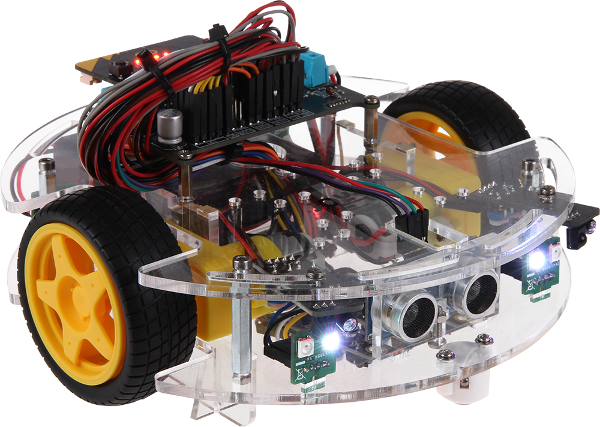
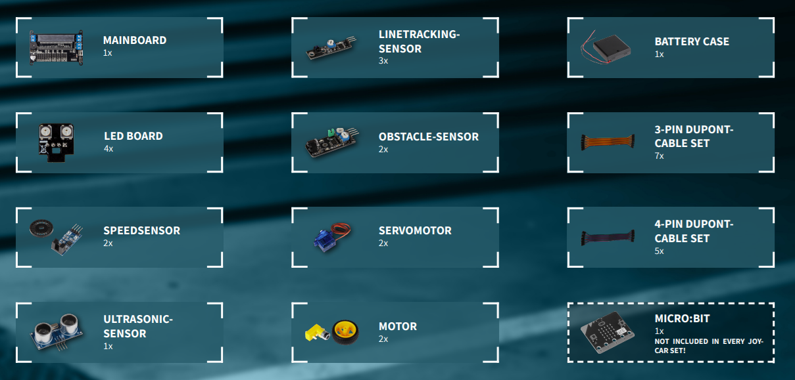
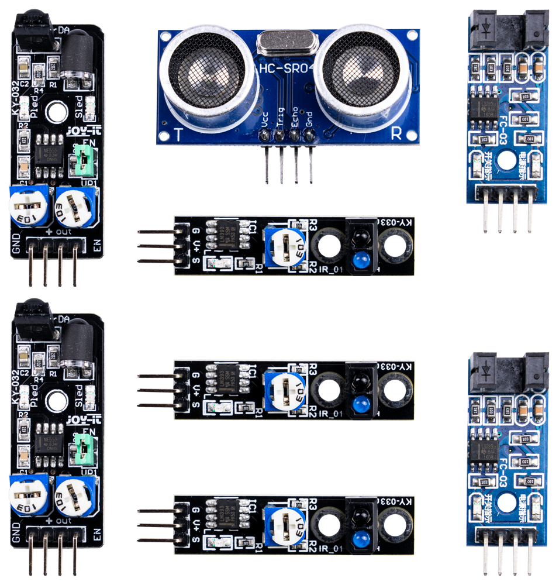
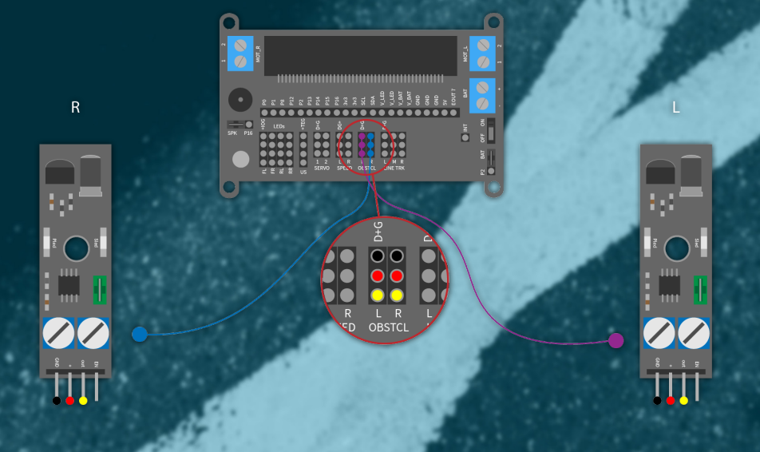
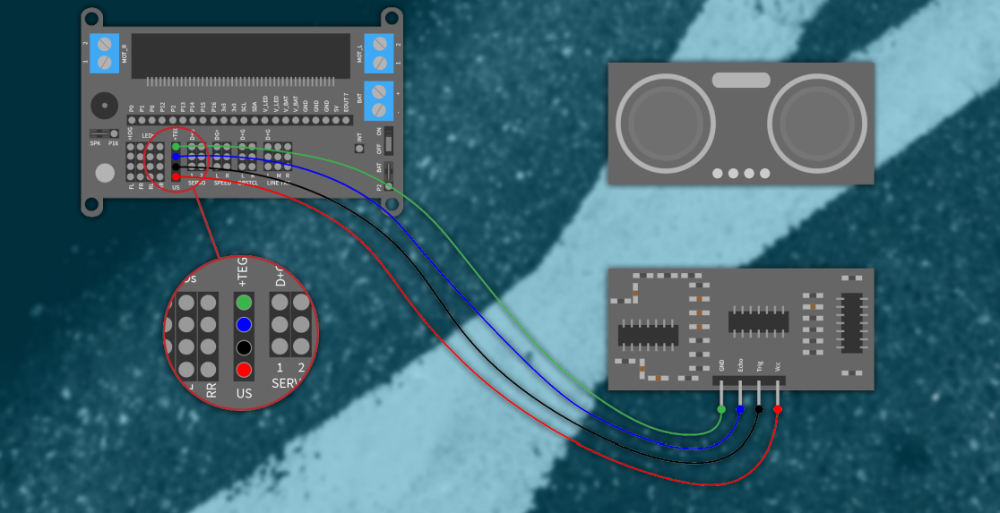
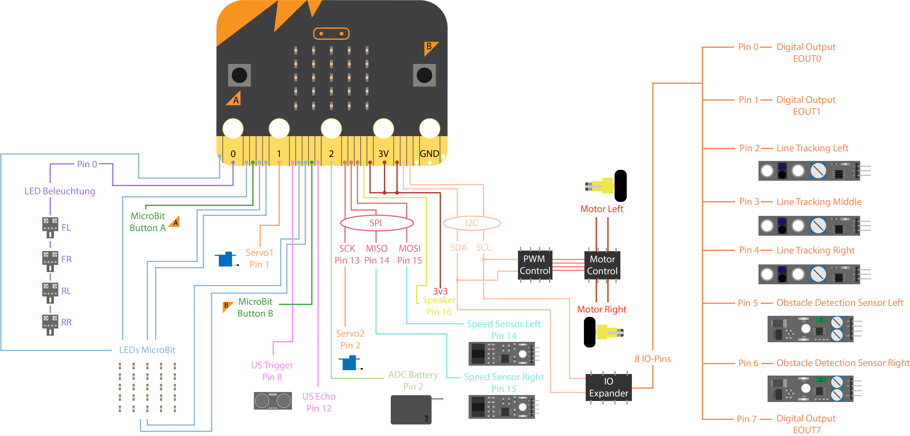
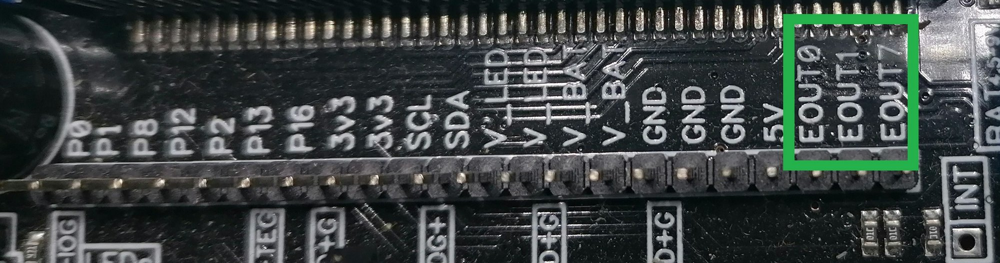

# 5. Mechanická montáž a zapojení robota JoyCar

V této kapitole si krok za krokem sestavíte samotného robota **JoyCar** – od mechanické montáže podvozku a motorů, přes osazení senzorů, až po správné zapojení veškeré kabeláže k základní desce.

  
   
  <em>Kompletně sestavený robot JoyCar s otočnou ultrazvukovou hlavou na servomotoru</em>

---

## 1. Obsah balení a kontrola dílů

Před zahájením montáže doporučujeme vybalit a zkontrolovat všechny součástky stavebnice.

### A. Elektronické moduly a senzory:

| Součástka | Počet | Popis a funkce v robotovi |
| :--- | :---: | :--- |
| **Základní deska (Mainboard)** | 1× | Řídicí deska se slotem pro Pico:ed / micro:bit, budičem motorů PCA9633 a I²C expandérem |
| **Senzor sledování čáry (Line Tracking)** | 3× | Infračervené reflexní snímače podvozku pro detekci černé čáry (L, M, R) |
| **Senzor překážek (Obstacle Sensor)** | 2× | Infračervené snímače přiblížení pro detekci překážek před robotem |
| **Snímač rychlosti (Speed Sensor)** | 2× | Optické štěrbinové snímače (optozávory) pro odměřování otáček motorů (enkodéry) |
| **LED světelný modul** | 4× | RGB LED moduly světlometů a blinkrů (přední FL, FR a zadní RL, RR) |
| **Ultrazvukový senzor (HC-SR04)** | 1× | Snímač vzdálenosti pro bezkontaktní měření objektů |
| **Servomotor (SG90)** | 2× | Mikroserva s vlastním kabelem (hnědá, červená, žlutá) pro natáčení ultrazvukového snímače |
| **Stejnosměrný motor TT s převodovkou** | 2× | Pohonné motory kol se dvěma výstupními hřídelemi (vnější pro kolo, vnitřní pro enkodér) |
| **Bateriové pouzdro** | 1× | Pouzdro pro 4× AA baterie s vypínačem a vývodem vodičů |
| **Sada 3pinových kabelů** | 7× | 3žilové kabely s barvami: **černá (GND), červená (VCC / +), žlutá (Data)** pro senzory čáry, překážek a rychlosti |
| **Sada 4pinových kabelů** | 5× | 4žilové kabely s barvami: **černá, zelená, modrá, červená** pro 4 LED moduly a ultrazvuk |

---

### B. Akrylové a mechanické díly podvozku:

| Díl | Počet | Umístění a účel |
| :--- | :---: | :--- |
| **Spodní základna (Base)** | 1× | Spodní akrylová deska nesoucí motory, spodní senzory čáry a opěrné kuličky |
| **Horní šasi (Chassis)** | 1× | Horní akrylová platforma nesoucí základní desku, servo a ultrazvuk |
| **Držáky motorů (Motor Brackets)** | 2× | Svislé akrylové díly pro uchycení motorů k základně |
| **Držáky baterie (Battery Brackets A, B, C)** | 1× od každého | Ohradní konstrukce fixující bateriové pouzdro |
| **Držák serva (Servo Bracket)** | 1× | Držák pro montáž mikroserva |
| **Držák ultrazvuku (Ultrasonic Bracket)** | 1× | Deska s otvory pro oči ultrazvukového snímače |
| **Distanční podložka zadní kuličky (Spacer)** | 1× | Vyrovnávací podložka pro zadní opěrnou kuličku |
| **Parkovací stojánky (Parking Brackets A 4×, B 2×)** | 6× | Servisní stojánek pro robota během programování a testování |

---

### C. Spojovací materiál:
- **Šrouby:**
  - 4× M2,5 × 5 mm (pro základní desku a LEDky)
  - 12× M2,5 × 10 mm (pro senzory a držák baterie)
  - 4× M2,5 × 22 mm (dlouhé šrouby procházející tělem motorů)
  - 6× M3 × 8 mm (pro spojení šasi a motorových držáků)
  - 5× M3 × 14 mm (pro držáky baterie a ultrazvuku)
- **Distanční sloupky:**
  - 4× M3 × 30 mm kovové sloupky (spojují spodní základnu a horní šasi)
  - 4× M2,5 × 10 mm distanční sloupky (pro uchycení hlavní desky / Mainboardu k hornímu šasi)
- **Matice a podložky:**
  - 20× matice M2,5 + 30× podložka M2,5
  - 15× matice M3
- **Další díly:**
  - 2× kovová opěrná kulička (Ball Caster)
  - 2× žluté pojezdové kolo s gumovou pneumatikou
  - 2× perforovaný kotouček enkodéru
  - 15× stahovací páska

> [!IMPORTANT]
> **Ochranná fólie na akrylových dílech:**  
> Všechny průhledné akrylové desky jsou z výroby polepeny krycí matnou papírovou nebo plastovou fólií, která chrání díly před poškrábáním. **Před zahájením montáže tuto fólii ze všech dílů pečlivě sloupněte**, aby byl podvozek dokonale čirý.

---

## 2. Postup mechanické montáže

### Krok 1: Montáž spodní základny (Base)
1. **Distanční sloupky:** Do spodní desky (Base) zašroubujte **4 vysoké kovové distanční sloupky (M3 × 30 mm)** a zespodu je pevně dotáhněte maticemi M3.
2. **Opěrné kuličky (Ball Casters):**
   - **Přední kulička:** Přišroubujte přímo k přední části základny pomocí šroubků dodaných s kuličkou.
   - **Zadní kulička:** Na zadní část základny položte vyrovnávací akrylovou podložku (**Spacer**) a kuličku připevněte delšími šroubky M2,5 × 10 mm a maticemi. *(Podložka je nutná, aby byl podvozek zcela vodorovný).*
3. **Držák bateriového pouzdra:**
   - Na horní stranu základny položte díl **Battery Bracket A** (kratší výstupek směřuje ke středu).
   - Na širší stranu připevněte díl **Battery Bracket B** šroubky M2,5 × 10 mm a maticemi M2,5.
   - Na užší stranu upevněte díl **Battery Bracket C** šroubky M3 × 14 mm a maticemi M3.

---

### Krok 2: Montáž pohonné jednotky (motory a kola)
1. **Usazení motorů do držáků:**
   - Každý žlutý motor vložte do příslušného akrylového držáku motoru (**Motor Bracket**).
   - Prostrčte dlouhé šrouby **M2,5 × 22 mm** skrz motor i držák.
   - **Důležité:** Použijte podložky M2,5 z obou stran (jednu pod hlavu šroubu a druhou pod matici).
2. **Nasazení perforovaných disků enkodérů:**
   - Na **vnitřní** osu každého motoru (směřující dovnitř robota) opatrně nasuňte černý děrovaný plastový kotouček enkodéru.
3. **Uchycení motorů k základně:**
   - Sestavené držáky motorů usaďte do zámků ve spodní základně.
   - Do boční drážky v akrylovém držáku motoru nejprve zasuňte matici **M3** a zespodu základny držák pevně přišroubujte šroubem **M3 × 14 mm**.
4. **Nasazení kol:**
   - Na **vnější** osu každého motoru pevně nasuňte pojezdová žlutá kola.

---

### Krok 3: Osazení senzorů a modulů
1. **Snímače rychlosti (Speed Sensors / Enkodéry):**
   - Vložte snímače rychlosti do spodní strany základny tak, aby U-profil optozávory procházel obdélníkovým výřezem vzhůru kolem perforovaného kotoučku motoru.
   - Přišroubujte je šrouby **M2,5 × 10 mm** a maticemi **M2,5** (použijte **2 ploché podložky M2,5** na každý šroub).
   - > [!WARNING]
   - > **Vyrovnání optické štěrbiny vůči kotoučku:**  
   - > Snímač rychlosti se musí pečlivě vyrovnat (případně mechanicky mírně podložit podložkou), aby perforovaný kotouček enkodéru procházel přesně středem štěrbiny optozávory a nikde nedrhnul o stěny senzoru. Jakmile je zapnuto napájení, při otáčení kola musí signální LED dioda zřetelně blikat (podrobněji viz sekce oživení níže).
2. **Senzory sledování čáry (Line Tracking L, M, R):**
   - Montují se ze **spodní strany základny (Base)** čelem k zemi **PŘÍMO BEZ DISTANČNÍCH SLOUPKŮ**.
   - K montáži použijte šroubky **M2,5 × 10 mm**, **dvě ploché podložky M2,5 na každý šroubek** a matice **M2,5**.
   - Šroub se prostrčí zespodu skrz podložku, tělo senzoru a desku základny, shora se nasadí druhá podložka a matice M2,5. Senzor doléhá přímo na spodní akrylovou desku, čímž je optické reflexní čidlo drženo v optimální pracovní výšce (cca 5–8 mm nad dráhou). *(Pokud byste použili distanční sloupky, senzory by drhly o zem a podvozek by na nich visel).*
3. **Příprava horního šasi (sloupky pro základní desku):**
   - Do 4 příslušných montážních otvorů v horní desce (Chassis) zašroubujte **4 malé distanční sloupky (M2,5 × 10 mm)** a zespodu je pevně dotáhněte maticemi M2,5. *(Pozor na orientaci šasi: dva oválné výřezy se nacházejí na levé straně ve směru jízdy).* Na tyto sloupky bude později usazena základní deska robota.
4. **Senzory překážek (Obstacle Sensors):**
   - Přišroubujte šikmo zespodu na boční křidélka horního šasi šrouby M2,5 × 10 mm, podložkami a maticemi M2,5.
5. **LED světelné moduly (FL, FR, RL, RR):**
   - Zasuňte do zářezů v rozích podvozku a zajistěte šroubky M2,5 × 5 mm.
6. **Ultrazvukový senzor se servomotorem (pro kurz ZSaPR je NUTNÁ montáž na servo!):**
   > [!IMPORTANT]
   > **Pro náš kurz ZSaPR je montáž ultrazvuku na servomotor povinná!** Pevnou montáž na spodní základnu nepoužívejte – robot potřebuje mít možnost aktivně otáčet „hlavou“, skenovat prostor před sebou do stran a vyhledávat překážky pod různými úhly.

   **Postup montáže otočné hlavy se servem:**
   1. **Usazení mikroserva do horního šasi:** Do obdélníkového výřezu v horní akrylové desce (Chassis) zasuňte mikroservo **SG90**. Nejprve otvorem protáhněte servokabel směrem dolů a pak do výřezu usaďte tělo serva (výstupní ozubená hřídelka směřuje dopředu).
   2. **Vystředění a zajištění páky serva:** Na ozubenou hřídelku nasaďte plastové jednoramenné raménko (páku) serva tak, aby při středové poloze (cca 90°) směřovalo přímo dopředu v ose jízdy robota. Zajistěte jej malým středovým vrutem z příslušenství serva.
   3. **Sestavení držáku ultrazvuku:** Spojte akrylový držák ultrazvuku (**Ultrasonic Bracket**) a držák serva (**Servo Bracket**) pomocí šroubu **M3 × 14 mm** a matice **M3**.
   4. **Připevnění k páce serva:** Sestavený držák přiložte k raménku serva a pevně jej přitáhněte dvěma přiloženými stahovacími plastovými páskami (prostrčí se otvory v držáku a v raménku serva). Přebytky pásek opatrně odstřihněte.
   5. **Zasunutí ultrazvukového senzoru:** Senzor HC-SR04 zatlačte oběma válcovými měniči („očima“) do kruhových otvorů v držáku.  
      *(Pozor: 4 připojovací piny senzoru musí směřovat **nahoru**, aby k nim byl snadný přístup pro zapojení kabelu).*

---

## 3. Zapojení kabeláže k základní desce

> [!CAUTION]
> ### ⚠️ Přehled kabelů ve stavebnici vs. barevné značení:
> V oficiálních nákresech výrobce Joy-IT jsou barvy kabelů znázorněny odlišně od skutečnosti.  
> **Ve stavebnici JoyCar pracujete se 3 typy kabelů s konkrétními barvami:**
> 
> 1. **3žilové kabely (7×) – barvy: `Černá` – `Červená` – `Žlutá`**  
>    - Používají se pro: **3× senzory čáry**, **2× senzory překážek** a **2× snímače rychlosti**.
>    - Standardní logika: **Černá** = Zem (`GND`), **Červená** = Napájení (`+3,3 V`), **Žlutá** = Data (`Signál`).
> 
> 2. **4žilové kabely (5×) – barvy: `Černá` – `Zelená` – `Modrá` – `Červená`**  
>    - Používají se pro: **4× LED moduly světel** a **1× ultrazvukový senzor**.
>    - Krajní vodiče odpovídají napájení (**Červená** = `+3,3 V`, **Černá** = `GND`), vnitřní vodiče (**Zelená** a **Modrá**) přenášejí řídicí a datové signály.
> 
> 3. **Integrovaný kabel servomotoru SG90 – barvy: `Hnědá` – `Červená` – `Žlutá`**  
>    - Tento kabel vede neoddělitelně přímo z těla serva.
>    - **Hnědá** = Zem (`G`), **Červená** = Napájení (`+`), **Žlutá** = PWM signál (`D`).
> 
> ---
> 
> **ZVLÁŠTNÍ POZOR NA SNÍMAČE RYCHLOSTI (`SPEED`):**  
> Na základní desce (`SPEED`) i na samotném snímači rychlosti je **stejné pořadí pinů** (`+`/`VCC`, `G`/`GND`, `D`/`D0`).  
> 3žilový kabel tedy spojuje správné piny navzájem (pin 1 do 1, pin 2 do 2, pin 3 do 3). Elektricky vše funguje, **ale barvy kabelu jsou opticky obráceně**:  
> - Černý drát propojuje `+` (3,3 V)  
> - Červený drát propojuje `GND` (zem)  
> 
> 👉 **Student má dvě správné možnosti:**  
> - **Možnost A (rychlá / „barvoslepá“):** Ponechá kabel tak, jak je (1:1). Elektricky je to v pořádku a nic se nespálí, jen je napájení na černém a zem na červeném.  
> - **Možnost B (elektrotechnicky čistá):** Prohodí černý a červený vodič v DuPont pouzdře **na OBOU koncích kabelu**, aby červená byla opravdu `+` a černá `GND`. *(Pozor: Nikdy neprohazujte vodiče jen na jednom konci, to by způsobilo zkrat a přepólování!).*

> [!TIP]
> **Kdy zapojovat:**  
> Základní desku a horní šasi zatím nepřišroubovávejte k distančním sloupkům. Nejprve pohodlně protáhněte všechny kabely otvory v šasi a zapojte je do pinů základní desky.

---

### A. Senzory sledování čáry (Line Tracking)

Propojte 3pinovými kabely do pinového bloku označeného **`LINE TRK`**:
- **L** (levý senzor) $\rightarrow$ sloupec `L`
- **M** (střední senzor) $\rightarrow$ sloupec `M`
- **R** (pravý senzor) $\rightarrow$ sloupec `R`
- Orientace řad: horní řada je signál **`D`** (žlutá), prostřední je **`+`** / 3,3 V (červená) a spodní je **`G`** / zem (černá). Na senzorech čáry odpovídá toto pořadí kabelu přímo.

---

### B. Snímače rychlosti (Speed Sensors / Enkodéry)

Propojte do pinového bloku označeného **`SPEED`**:
- **L** (levý enkodér) $\rightarrow$ sloupec `L`
- **R** (pravý enkodér) $\rightarrow$ sloupec `R`

> [!IMPORTANT]
> ### 🔍 Pořadí pinů na desce a snímači vs. barvy kabelu:
> Podívejte se pozorně na popisek pinů na základní desce JoyCaru u bloku `SPEED` a na destičce snímače rychlosti:
> 
> | Pin | Základní deska (`SPEED`) | Snímač rychlosti | Běžný 3žilový kabel | Co to v praxi znamená? |
> | :---: | :---: | :---: | :---: | :--- |
> | **Pin 1** | **`+`** (3,3 V) | **`VCC`** (napájení) | **Černý vodič** | Pořadí pinů na desce i snímači je **shodné**! |
> | **Pin 2** | **`G`** (Zem) | **`GND`** (zem) | **Červený vodič** | Kabel propojuje správné piny navzájem... |
> | **Pin 3** | **`D`** (Signál) | **`D0`** (digitální OUT) | **Žlutý vodič** | ...ale napájení je vedeno černým a zem červeným! |
> | *(Pin 4)* | *(není)* | **`A0`** (analogový výstup) | *(nezapojeno)* | **Čtvrtý pin A0 zůstává volný!** |
> 
> **Jak to zapojit (2 správné cesty):**
> 1. **Rychlá varianta („barvoslepá“):**  
>    Zapojte 3pinový kabel z desky do snímače přímo (1:1 na piny VCC, GND, D0) bez jakýchkoliv úprav. Elektricky je zapojení naprosto funkční a bezpečné, jen musíte vědět, že v tomto konkrétním spoji vede kladné napětí černý vodič a zem červený vodič.
> 2. **Profesionální varianta (prohození na OBOU koncích):**  
>    Pokud chcete striktně dodržet barevné značení (červená = +, černá = GND), musíte opatrně hrotem jehly nebo nožíku nadzvednout plastové jazýčky DuPont konektoru a prohodit černý a červený vodič **na obou koncích kabelu**!  
>    *(Pozor: Pokud byste vodiče prohodili pouze na jednom konci, došlo by k přepólování snímače!).*

---

### C. Senzory překážek (Obstacle Sensors)

Propojte 3pinovými kabely do pinového bloku označeného **`OBSTCL`**:
- **L** (levý senzor) $\rightarrow$ sloupec `L`
- **R** (pravý senzor) $\rightarrow$ sloupec `R`
- > [!WARNING]
  > Tyto senzory mají rovněž **4 piny**, ale zapojují se pouze **3 vodiči** (`GND`, `+` a `OUT`). Pin `EN` (Enable) zůstává nezapojen!

---

### D. LED světelné moduly

Každý modul má 4 piny a propojuje se 4pinovým kabelem (barvy vodičů: **černá, zelená, modrá, červená**) do konektoru **`LEDs`**:
- **FL** = Front Left (Přední levé světlo)
- **FR** = Front Right (Přední pravé světlo)
- **RL** = Rear Left (Zadní levé světlo)
- **RR** = Rear Right (Zadní pravé světlo)

---

### E. Ultrazvukový senzor vzdálenosti

Ultrazvukový senzor HC-SR04 je usazen v akrylovém držáku nahoře na mikroservu v horním šasi. Propojte jej 4pinovým kabelem (barvy vodičů: **černá, zelená, modrá, červená**) do svislého bloku pinů označeného **`US`**:
- Piny shora dolů odpovídají popisu na desce i senzoru:
  - **`+`** $\rightarrow$ `VCC` senzoru (**červený vodič**)
  - **`T`** $\rightarrow$ `Trig` Trigger signál (**modrý vodič**)
  - **`E`** $\rightarrow$ `Echo` Echo signál (**zelený vodič**)
  - **`G`** $\rightarrow$ `GND` Zem (**černý vodič**)
- *Krajní vodiče 4žilového pásku tedy odpovídají napájení (+ červená, GND černá).*

---

### F. Servomotory

Mikroservo SG90 má svůj vlastní 3žilový kabel s koncovkou v barvách **hnědá, červená, žlutá**. Zasouvá se přímo do pinového bloku **`SERVO`**:
- **1** $\rightarrow$ Servo pro natáčení ultrazvukové hlavy (pin 1 – **povinné pro kurz**)
- **2** $\rightarrow$ Volitelné druhé servo (pin 2 – např. pro budoucí náklon / tilt)
- *Orientace konektoru:*
  - **`G`** $\rightarrow$ **Hnědý vodič** (zem / GND)
  - **`+`** $\rightarrow$ **Červený vodič** (napájení +3,3 V / VCC)
  - **`D`** $\rightarrow$ **Žlutý / oranžový vodič** (řídicí PWM signál)

---

### G. Stejnosměrné motory

Vodiče od obou motorů zasuňte do postranních šroubovacích svorkovnic na desce JoyCaru:
- **`MOT_L`** (levá modrá svorkovnice) $\rightarrow$ vodiče levého motoru
- **`MOT_R`** (pravá modrá svorkovnice) $\rightarrow$ vodiče pravého motoru
- Plochým šroubovákem svorky pevně dotáhněte, aby vodiče za jízdy nevypadly.  
  *(Pokud by se po spuštění motor točil opačně, stačí prohodit dvojici vodičů v dané svorkovnici).*

---

### H. Bateriové pouzdro (napájení)

Dvojice vodičů z battery packu se zapojuje do modré svorkovnice označené **`BAT`** (na pravé straně vedle vypínače ON/OFF):
- **Červený vodič** $\rightarrow$ svorka **`+`**
- **Černý vodič** $\rightarrow$ svorka **`−`**
- Bateriové pouzdro zasuňte do akrylového držáku na spodní desce.

---

## 4. Finální kompletace („Svatba“ šasi a desky)

1. **Uložení kabeláže:** Všechny volné kabely srovnejte, aby nezasahovaly do rotujících kol ani optozávory enkodérů. Můžete je stáhnout dodanými plastovými páskami.
2. **Připevnění horního šasi:** Horní akrylovou desku (Chassis) usaďte na 4 vysoké distanční sloupky (M3 × 30 mm) a shora ji přišroubujte čtyřmi šrouby **M3 × 8 mm**.
3. **Upevnění základní desky:** Desku JoyCar položte na horní distanční sloupky šasi a zajistěte čtyřmi šroubky **M2,5 × 5 mm**.
4. **Vložení desky Pico:ed:**
   - Desku **Pico:ed v2** (nebo micro:bit) opatrně zasuňte hranovým konektorem do slotu na základní desce.
   - **Tlačítka A a B i LED displej musí směřovat dopředu/nahoru!**

---

## 5. Oživení, kontrola a kalibrace senzorů (Poznatky z praxe)

Jakmile je robot mechanicky sestaven a kabely propojeny se základní deskou, je před spuštěním programů jízdy naprosto nezbytné **zkontrolovat a zkalibrovat všechny optické senzory**. Všechny tyto senzory jsou vybaveny indikačními LED diodami přímo na svých deskách, které umožňují okamžité ověření správné funkce pouhým pohledem.

Zapněte hlavní vypínač robota (přepínač ON/OFF vedle modré svorkovnice baterie).

---

### A. Snímače rychlosti (Speed Sensors) – kontrola vyrovnání a blikání LED
Optické štěrbinové snímače odměřují ujetou vzdálenost a rychlost otáčení kol. 

* **Dvojice LED diod na snímači rychlosti:**
  1. **Napájecí LED:** Svítí trvale, jakmile je zapnuto napájení robota.
  2. **Signální / detekční LED:** Reaguje na střídavé clonění paprsku štěrbinami v disku enkodéru.
* **Ověření v praxi:**
  - Zvedněte robota ze stolu a rukou pomalu otáčejte příslušným pojezdovým kolem.
  - Sledujte signální LED diodu na snímači: **při otáčení kola musí tato LED zřetelně střídavě blikat** (rozsvěcet se v otvorech a zhasínat při zaclonění lamely, nebo naopak).
  - Pokud LED dioda trvale svítí nebo trvale nesvítí, kotouček neprochází optickou osou, je křivý nebo drhne o stěnu snímače. Povolte upevňovací šroub snímače a polohu mechanicky dorovnejte (případně podložte podložkou), dokud při otáčení kola spolehlivě nebliká.

---

### B. Senzory sledování čáry (Line Tracking) – kalibrace citlivosti a vliv osvětlení
Tři reflexní infračervené snímače na podvozku detekují kontrast mezi světlým povrchem dráhy a tmavou vodicí čarou. Každý snímač má na horní straně malý otočný trimr (potenciometr) pro jemné nastavení prahové hodnoty komparátoru.

* **Dvojice LED diod na každém senzoru čáry:**
  1. **Napájecí LED:** Svítí nepřetržitě při zapnutém podvozku.
  2. **Detekční LED (reakce na odraz světla):**
     - **Nad bílým papírem / světlou plochou:** Infračervené světlo se odrazí zpět do přijímače $\rightarrow$ **detekční LED se rozsvítí**.
     - **Nad černou čarou:** Černý pigment pohltí infračervené záření, odraz zmizí $\rightarrow$ **detekční LED zhasne**.
* **Postup kalibrace potenciometru:**
  1. Položte robota na dráhu tak, aby všechny 3 senzory byly nad světlým podkladem dráhy (mimo čáru).
  2. Malým plochým šroubovákem opatrně otáčejte potenciometrem příslušného senzoru, dokud se detekční LED spolehlivě nerozsvítí.
  3. Následně robotem najeďte tak, aby byl daný senzor přímo nad černou čarou. Detekční LED musí **okamžitě a spolehlivě zhasnout**.
  4. Postup zopakujte pro všechny 3 senzory (L, M, R), aby měly shodnou odezvu.

> [!IMPORTANT]
> ### ⚠️ Zásadní poznatek z praxe – vliv okolního světla a materiálu dráhy:
> Infračervené reflexní senzory jsou velmi citlivé na úroveň okolního osvětlení a typ materiálu podkladu!
> - **Změna světla v místnosti:** Pokud se během práce změní světelné podmínky v učebně (např. vyjde prudké slunce, zatáhnou se žaluzie, rozsvítí se zářivky či se zešeří), **je nutné provést kalibraci potenciometrů znovu!**
> - **Změna podkladu:** Pokud přenesete robota z kancelářského papíru na velkoformátové linoleum, křídový papír nebo plotterový tisk, odrazivost povrchu je odlišná a prahy je nutné opětovně doladit. V opačném případě bude robot buď ztrácet stopu, nebo vyhodnotí celý povrch jako čáru.

---

### C. Senzory překážek (Obstacle Sensors) – dosah a reakce na přiblížení ruky
Přední infračervené senzory detekují překážky před robotem. Na rozdíl od senzorů čáry mají tyto senzory **dva nezávislé potenciometry** – jeden reguluje výkon infračervené vysílací diody a druhý citlivost přijímače.

* **Dvojice LED diod na senzoru překážek:**
  1. **Napájecí LED:** Svítí trvale.
  2. **Detekční LED (překážka v dosahu):**
     - Pokud před senzorem nic není (volný prostor), detekční LED je **zhasnutá**.
     - Jakmile před senzor přiblížíte ruku nebo překážku (v požadované vzdálenosti cca 5–20 cm), detekční LED se **okamžitě rozsvítí**.
* **Nastavení potenciometrů:**
  - Otáčením trimru **ve směru hodinových ručiček** citlivost a dosah senzoru **zvyšujete** (detekuje na větší vzdálenost).
  - Otáčením **proti směru hodinových ručiček** citlivost a dosah **snižujete**.
  - Nastavte trimry tak, aby senzor spolehlivě reagoval na ruku či stěnu před sebou, ale současně falešně nereagoval na podlahu nebo stůl před robotem.

---

## 6. Blokové schéma zapojení a architektura JoyCaru

Pro porozumění tomu, jak mikrokontrolér s jednotlivými periferiemi komunikuje, slouží toto oficiální blokové schéma architektury:

### Klíčové principy zapojení desky:
1. **I²C expandér (PCF8574 / 8 IO pinů, adresa `0x38`):**  
   Protože mikrokontrolér má omezený počet pinů, většina diskrétních senzorů je připojena přes 8bitový I²C expandér:
   - `Pin 0` $\rightarrow$ Volný pin **`EOUT0`** na hlavní liště
   - `Pin 1` $\rightarrow$ Volný pin **`EOUT1`** na hlavní liště
   - `Pin 2` $\rightarrow$ Levý senzor čáry (`Line Tracking Left`)
   - `Pin 3` $\rightarrow$ Prostřední senzor čáry (`Line Tracking Middle`)
   - `Pin 4` $\rightarrow$ Pravý senzor čáry (`Line Tracking Right`)
   - `Pin 5` $\rightarrow$ Levý senzor překážek (`Obstacle Sensor Left`)
   - `Pin 6` $\rightarrow$ Pravý senzor překážek (`Obstacle Sensor Right`)
   - `Pin 7` $\rightarrow$ Volný pin **`EOUT7`** na hlavní liště  
   *(Volné piny EOUT0, EOUT1 a EOUT7 v pokročilé části kurzu využijeme pro připojení dalších 3 senzorů čáry!)*

   
2. **Řízení motorů (PWM + Direction):**  
   Motory jsou řízeny specializovaným I²C PWM čipem **PCA9633**, který generuje PWM signály pro levý i pravý motor.
3. **Přímo vyvedené piny mikrokontroléru:**
   - `Pin 0` $\rightarrow$ Sběrnice LED osvětlení (WS2812 / NeoPixel)
   - `Pin 1` $\rightarrow$ Servo 1
   - `Pin 2` $\rightarrow$ Servo 2 / Analogové měření napětí baterie
   - `Pin 8` $\rightarrow$ Ultrazvuk Trigger
   - `Pin 12` $\rightarrow$ Ultrazvuk Echo
   - `Pin 14` $\rightarrow$ Levý snímač otáček (Speed Sensor Left)
   - `Pin 15` $\rightarrow$ Pravý snímač otáček (Speed Sensor Right)
   - `Pin 16` $\rightarrow$ Vestavěný bzučák (Speaker)

---

## 7. Odkazy na oficiální manuály výrobce (PDF)

Pokud si chcete prohlédnout originální výkresy a vícejazyčnou dokumentaci přímo od výrobce Joy-IT:
- 📄 **[JoyCar - Český návod na stavbu (PDF)](https://1drv.ms/b/c/c957b235b7cc93a4/Eab-319kKGBIn5wD8yF1_7cBHh4y8a4HqV2_g_H2rLpG_Q?e=JoyCarCZ)**
- 📄 **[JoyCar - Oficiální anglický manuál MB-Joy-Car Manual (PDF)](https://joy-it.net/files/files/produkte/mb-joy-car/MB-Joy-Car_Manual_2021-04-30.pdf)**

---

**Gratulujeme! Váš robot JoyCar je mechanicky sestaven a kompletně zapojen.**  
Nyní můžete pokračovat na další kapitolu a začít oživovat pohon a senzory:

➡️ **Pokračovat na [6. Ovládání motorů robota JoyCar](6-ovladani-motoru.md)**
