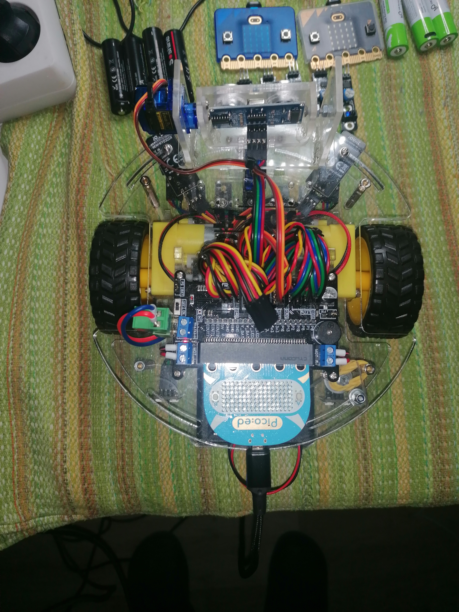
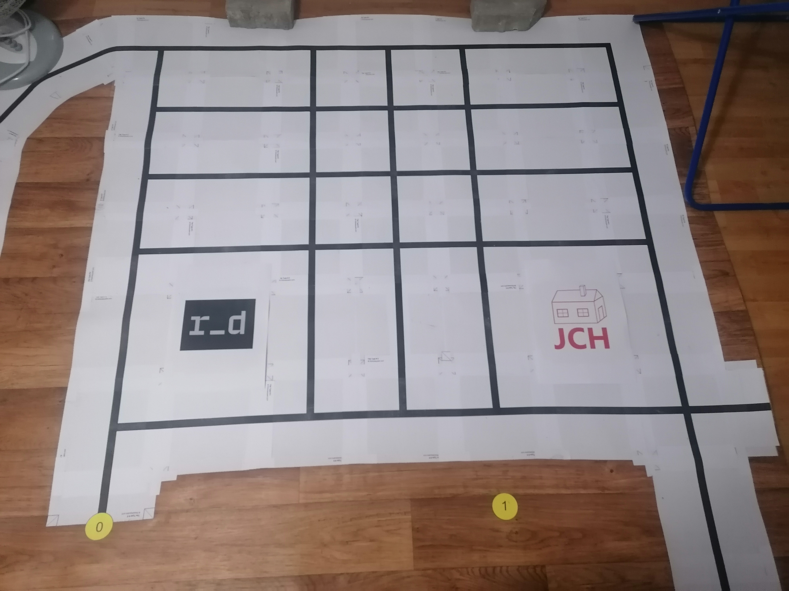
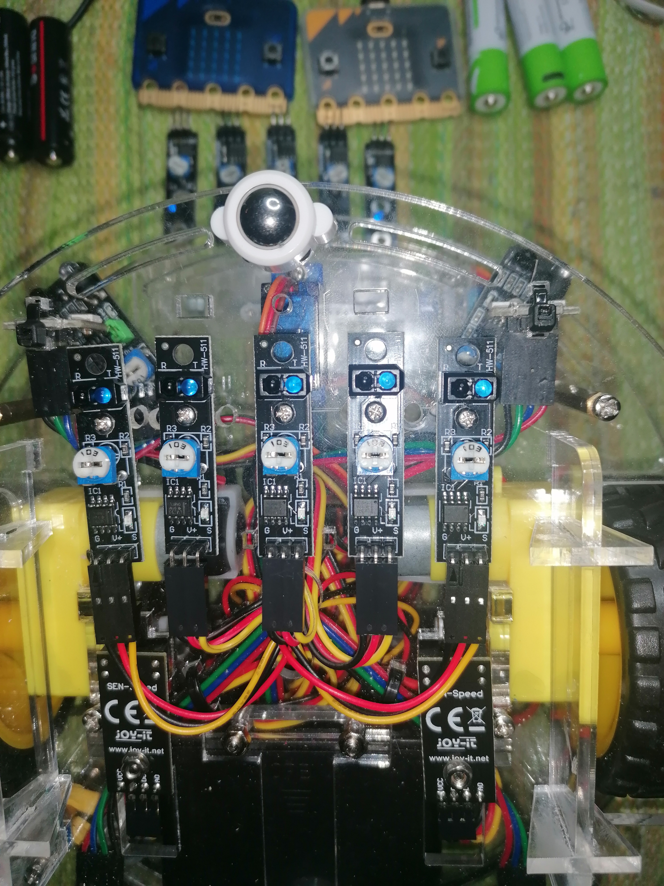
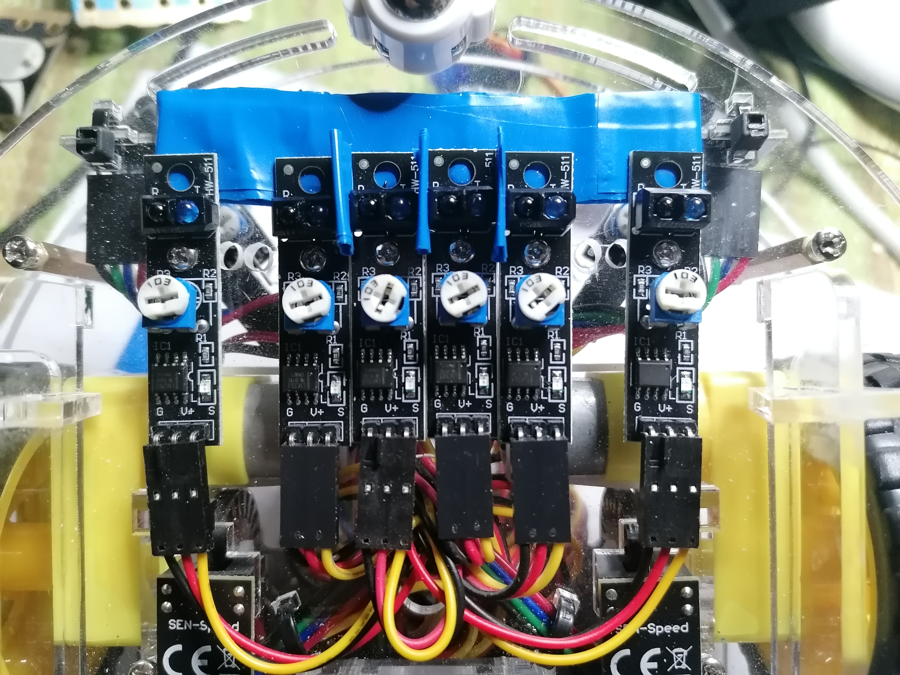

# 5. Praktické tipy, mapy a vylepšení výbavy (nepovinné)

Tato kapitola je **nepovinná a rozšiřující**. Shrnuje osvědčené zkušenosti z praxe mentora a absolventů minulých běhů kurzu. Najdete zde doporučení na užitečné doplňky k hardwaru, návody a odkazy ke stažení map pro sledování čáry i postup výroby vlastní odolné dráhy.

Tento dokument je živý – můžete jej v průběhu kurzu obohacovat o další vlastní nápady a vychytávky!

---

## 1. Užitečné doplňky k hardwaru

### 🧲 Magnetický microUSB kabel
Při vývoji a ladění kódu budete kabel k desce **Pico:ed** připojovat a odpojovat desítkykrát za večer. 
- **Riziko u běžného kabelu:** Časté zasunování a vyndávání konektoru namáhá microUSB port na desce. Pokud navíc robot nečekaně vyjede ze stolu nebo dráhy a kabel zůstane připojený, hrozí vytržení konektoru z plošného spoje.
- **Výhoda magnetického kabelu:** V portu desky Pico:ed zůstává trvale zasunutá miniaturní magnetická koncovka. Samotný kabel stačí přiblížit a magnet se sám bezpečně spojí. Pokud robot cukne nebo ujede, kabel se v magnetickém spoji bezpečně a bez poškození rozpojí.
- **Ověřený tip z praxe:**
  - [AlzaPower MagCore 2in1 USB-C / micro USB 3A (1,5 m)](https://www.alza.cz/alzapower-magcore-2in1-usb-c-micro-usb-3a-1-5m-cerny-d6486450.htm)
  - [AlzaPower MagCore 2in1 USB-C / micro USB 3A (2 m)](https://www.alza.cz/alzapower-magcore-2in1-usb-c-micro-usb-3a-2m-cerny-d6486452.htm)

<!-- Obrázek magnetického kabelu v desce:

-->

> [!NOTE]
> Magnetický kabel není povinný – veškerou práci zvládnete i s běžným microUSB kabelem. Jde o praktické doporučení pro ochranu desky a pohodlnější práci.

---

### 🔋 Baterie a napájení při dlouhém ladění
Robot JoyCar používá 4 ks speciálních **USB nabíjecích Li-ion akumulátorů**, které v sobě mají zabudovaný měnič udržující stabilní napětí **1,5 V** po celou dobu provozu (celkem 6 V pro robot).
- **Vlastnost těchto baterií:** Na rozdíl od běžných alkalických baterií jejich napětí s vybíjením neklesá, takže motory mají stále stejnou rychlost a senzory čtou stabilně. Jakmile se však akumulátor vybije, vestavěná elektronika jej **skokově vypne**.
- **Tipy z praxe:**
  - **Druhá sada baterií:** Mít po ruce náhradní sadu 4 ks baterií znamená, že zatímco se jedna sada nabíjí přes USB, vy můžete plynule pokračovat v práci.
  - **Externí zdroj 6 V:** Pro dlouhé statické ladění algoritmů na stole (např. kalibrace senzorů čáry, testování displeje nebo stavových automatů) lze robot napájet ze stabilizovaného zdroje 6 V DC s dostatečně dlouhým a ohebným přívodním kabelem.

---

## 2. Testovací mapa a dráha pro robota

Autonomní robot JoyCar se orientuje pomocí odrazových infračervených (IR) senzorů na spodní straně podvozku. Pro spolehlivou jízdu po čáře potřebuje **výrazný kontrast mezi světlým podkladem a černou čarou** (ideální šířka čáry je **přibližně 15 mm**, což přesně odpovídá standardní elektrikářské izolační pásce).

Existuje několik způsobů, jak si testovací dráhu připravit:

### Možnost A: Černá elektrikářská izolační páska (nejrychlejší řešení)
- Stačí zakoupit běžnou černou elektrikářskou pásku šířky **15 mm** (lze koupit v každém hobbymarketu nebo elektru za pár desítek korun).
- Nalepte ji na světlou podlahu, lamino desku nebo velký karton.
- *Pozor na ostré pravé úhly v zatáčkách – robot má svou setrvačnost a poloměr otáčení, proto je lepší začínat plynulými oblouky.*

---

### Možnost B: Modulární dlaždice RobotSquare (tisk na A4)
Velmi oblíbený systém modulárních papírových dlaždic, které si můžete vytisknout na běžné domácí tiskárně na papíry formátu A4 a poskládat z nich libovolnou trasu:
- 📖 [RobotSquare – Popis principu sledování čáry a dlaždic](https://robotsquare.com/2012/11/28/line-following/)
- 📄 [RobotSquare – PDF šablona dlaždic k přímému tisku (A4)](http://robotsquare.com/wp-content/uploads/2012/11/linefollowtiles.pdf)

---

### Možnost C: Oficiální předlohy map pro kurz (A1 / A3)
Pro finální projekt a křižovatky máme k dispozici připravené PDF šablony pro velkoformátový tisk:
- 📂 **[Odkaz na stažení souborů map z OneDrive](https://1drv.ms/f/c/c957b235b7cc93a4/IgC6aauu_nNZQrMK8IJcA2njASdURRjqxCBx6xwbaK_lPdo?e=lDsPzl)**
  - `maps.pdf` – obsahuje dva ovály pro jízdu po čáře a rozvržení křižovatek pro náš projekt (formát A1).
  - `maps - split to A3.pdf` – stejná mapa rozdělená na formát A3 pro tisk v běžných copycentrech.
  - `maps2.pdf` – dvě alternativní rozložení křižovatek pro pokročilejší testování.
  - `maps2 - split to A3.pdf` – verze maps2 rozdělená na listy A3.

---

### 💡 Návod: Jak vyrobit pevnou a srolovatelnou mapu na lino (zkušenost mentora)

Pokud máte doma málo místa a potřebujete dráhu po práci snadno uklidit, skvěle se osvědčil podklad z linolea:

1. **Příprava dlaždic:** Vytiskněte a pečlivě vystříhejte jednotlivé dlaždice na papíry formátu A4.
2. **Výběr rozměrů:** Vyberte místo v místnosti, kde budete dráhu rozkládat, a určete maximální rozměry.
3. **Základ z linolea:** Pořiďte kus běžného linolea nebo PVC podlahové krytiny odpovídajícího rozměru (často se dají velmi levně sehnat odřezky ve stavebninách či podlahářstvích).
   - *Výhoda linolea:* Je těžké a leží zcela rovně, nezvlní se jako papír, netrhá se a lze jej kdykoliv srolovat a postavit do kouta.
4. **Návrh tratě:** Rozložte dlaždice "nasucho" tak, aby dráha obsahovala jak rovinky a oblouky pro jízdu po čáře, tak křižovatky pro plnění úloh projektu.
5. **Lepení:** Jednotlivé díly pečlivě srovnejte podle čar (aby na sebe čáry plynule navazovaly bez schodů) a přilepte k linoleu lepidlem na papír nebo tenkou oboustrannou lepicí páskou.

> [!TIP]
> Výsledkem je rovný podklad s vysokým kontrastem bílé a černé, po kterém robot hladce přejíždí bez zadrhávání podvozku či senzorů.

<!-- Obrázky mapy na linoleu:



-->

---

## 3. 🔬 Hardwarový hack JoyCaru: Skutečné zapojení I2C expandéru a rozšíření až na 6 senzorů čáry

Tato sekce je **zcela nepovinná a slouží pro inspiraci a pokročilé experimenty**. Nebude vyžadována v žádném domácím úkolu, ale nabízí fascinující vhled do reálného hardwaru a řešení problémů z praxe.

### 🔍 Nezdokumentovaná změna výrobce – Kde jsou zapojené enkodéry rychlosti?
Podle oficiální dokumentace výrobce JoyCar by měly být všechny hlavní senzory připojeny k 8bitovému I2C expandéru **PCF8574** (adresa `0x38`):
- 2 senzory rychlosti (optické enkodéry otáčení kol)
- 2 senzory překážek (infračervené snímače přiblížení)
- 3 senzory sledování čáry  
*(Dohromady 7 senzorů obsazujících 7 bitů z 8).*

**Realita na naší verzi robota:**  
Výrobce provedl **nezdokumentovanou změnu zapojení základní desky**, která v minulém běhu kurzu způsobila velké trápení, protože senzory rychlosti nešlo z I2C expandéru vyčíst. Až noční měření šikovného hardwaráře kurzu odhalilo skutečnost:
- **Senzory rychlosti (enkodéry) NEJSOU připojeny k I2C expandéru!**
- Jsou zapojeny **přímo na piny P14 a P15** procesorové desky micro:bit / Pico:ed.

**Co to znamená pro nás?**  
Na I2C expandéru je reálně připojeno **pouze 5 senzorů** (3 čárové + 2 překážkové). **Celé 3 bity jsou zcela volné!**  
Tyto 3 nepoužité piny expandéru jsou vyvedeny na dlouhý rozšiřující konektor na horní straně základní desky JoyCaru a jsou popsané jako:
- **`EOUT0`** (bit 0 na I2C expandéru)
- **`EOUT1`** (bit 1 na I2C expandéru)
- **`EOUT7`** (bit 7 na I2C expandéru)

---

### 🚦 Proč 3 senzory čáry nestačí na spolehlivou detekci křižovatek?
- Pro samotnou jízdu po čáře stačí 2 diskrétní senzory.
- Pro detekci křižovatky by se na první pohled zdálo, že 3 senzory stačí (stačí přece, aby se aktivovaly 2 senzory najednou).
- **Proč to v praxi selhává:**  
  Při sledování čáry robot neustále jemně zatáčí zprava doleva a zpět (kmitá kolem čáry). Pokud robot dorazí k odbočce právě v momentě, kdy je krajním senzorem nad čárou, **odbočku zcela mine bez toho, aby ji kterýkoliv senzor zachytil**.  
  Pro spolehlivou a robustní detekci křižovatek je potřeba **alespoň 5 senzorů** (přidat na každý bok ještě jeden předsazený senzor).

---

### 🛠️ Možnost 1: Odpojení senzorů překážek a zapojení 2 přídavných senzorů čáry
Nejjednodušší cesta, jak získat 5 senzorů čáry:
1. Odpojte konektory obou předních senzorů překážek.
2. Místo nich připojte 2 dodatečné senzory čáry umístěné na boky podvozku.
3. Funguje to spolehlivě, ale robot přijde o možnost detekovat překážky před sebou těmito senzory.
4. Vyžaduje to vyvrtání dalších montážních otvorů do spodní desky podvozku pro upevnění senzorů.

<!-- Obrázky Možnosti 1:


-->

> [!TIP]
> **Video ukázka:** Podívejte se, jak lze stavy senzorů živě přenášet a vizualizovat na maticovém LED displeji Pico:edu:  
> 🎥 **[Video na OneDrive – Vizualizace senzorů na displeji](https://1drv.ms/v/s!AqSTzLc1slfJlJR_47mjA5mhaky1GQ?e=4n5zWL)**

---

### ⚡ Možnost 2 (Pokročilý tuning): Využití volných pinů EOUT – až 6 senzorů čáry i 2 senzory překážek!

Díky volným pinům I2C expandéru nemusíte senzory překážek odpojovat. Můžete připojit **až 3 další senzory čáry** a provozovat všech 8 bitů expandéru současně:
- Piny **`EOUT0`**, **`EOUT1`** a **`EOUT7`** na konektoru JoyCaru obsluhují signální vodiče (bity 0, 1 a 7).
- K senzoru je však potřeba přivést také **zem (GND / černý vodič)** a **napájení (VCC / červený vodič)**.

#### Výroba napájecí a signálové "kostky" (DIY adaptér):
1. Použijte standardní **dvouřadou kolíkovou lištu**.
2. Na liště propájejte 2 samostatné vodivé sběrnice (pro GND a pro napájení).
3. Kratší konce kolíků zespodu odštípněte a obruste dohladka.
4. Spodní stranu důkladně zaizolujte elektrikářskou páskou, aby nedošlo ke zkratu s deskou JoyCaru.
5. Vytiskněte a nasaďte papírový štítek s barevným značením pinů pro snadné zapojování.
6. Pomocí **3 propojovacích jumperů** přichyťte kostku ke konektoru JoyCaru – jumpery současně přivedou zem (GND) a mechanicky drží kostku na místě.

> [!CAUTION]
> **Kritické varování pro napájení expandéru (3,3 V vs. 5 V):**  
> Na konektoru JoyCaru se v bezprostřední blízkosti nachází pin **5V** (který by lákal k přímému propojení dalším jumperem).  
> **To nikdy nedělejte!** I2C expandér PCF8574 pracuje s logickou úrovní **3,3 V** a napětí 5 V by jej zničilo!  
> Proto použijte **krátký červený vodič**, kterým propojíte pin **3,3V** na konektoru JoyCaru s napájecí sběrnicí na adaptérové kostce.

Tím vzniknou 3 plnohodnotné 3pinové pozice pro senzory.

<!-- Obrázky adaptérové kostky:


-->

---

### 📐 Rozmístění 6 senzorů čáry zespodu podvozku

Výsledné rozmístění 6 senzorů na spodní desce robota nabízí vynikající vlastnosti:

```
[ Krajní levý ]      [ Vnitřní 1 ][ Vnitřní 2 ][ Vnitřní 3 ][ Vnitřní 4 ]      [ Krajní pravý ]
 (detekce křiž.)                  (jemné sledování 15mm čáry)                   (detekce křiž.)
```

1. **Vnitřní 4 senzory:**
   - Jsou natěsnané těsně vedle sebe.
   - Jsou tak blízko, že standardní černá čára šířky **15 mm** dokáže aktivovat i 2 sousední senzory najednou, pokud čára prochází mezi nimi.
   - Získáváte tak teoreticky **až 10 jemných stavů polohy čáry vůči podvozku**, což umožňuje odstupňovat více intenzit zatáčení pro dokonale plynulou jízdu bez trhavých pohybů.
2. **Krajní 2 senzory:**
   - Jsou oddělené větší mezerou směrem k okrajům robota.
   - Pro detekci křižovatky stačí současná aktivace dvou senzorů.
   - Běžné kmitání robota při jízdě po čáře na rovince tyto krajní senzory vůbec nezasáhne, takže křižovatku nikdy neminete ani omylem nezachytíte falešný odbočovací signál.

<!-- Obrázky rozmístění 6 senzorů:


-->

---

## 4. Užitečné studijní odkazy

### 🛠️ Práce s Git a GitHubem pro začátečníky:
- 🎥 **Video:** [Jak na Git a Git-Hub ve Visual Studio Code (YouTube video pro úplné začátečníky)](https://www.youtube.com/watch?v=0v5K4GvK4Gs)
- 📖 **Tahák příkazů:** [14 Git příkazů, které musí znát každý vývojář (Skillmea blog)](https://skillmea.cz/blog/14-git-prikazu-ktere-musi-znat-kazdy-vyvojar)

---

## 5. Prostor pro další vylepšení a nápady

Tuto sekci budeme v průběhu kurzu průběžně doplňovat. Pokud přijdete na zajímavý tip, 3D model (např. ochranné nárazníky, držáky čidel), úpravu nebo zlepšovák, pošlete nám jej a zařadíme ho sem pro ostatní!
