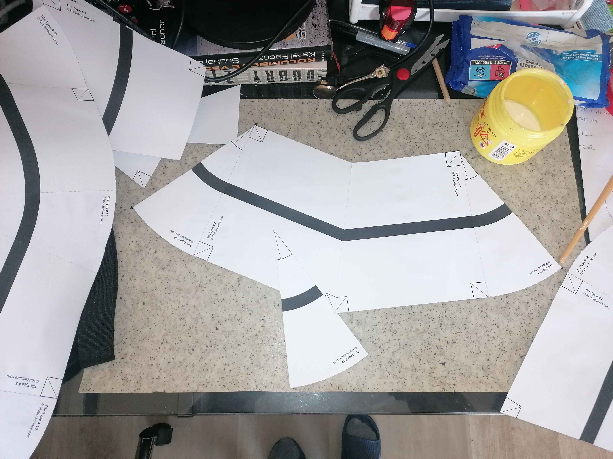

# 5. Praktické tipy, mapy a vylepšení výbavy (nepovinné)

Tato kapitola je **nepovinná a rozšiřující**. Shrnuje osvědčené zkušenosti z praxe mentora a absolventů minulých běhů kurzu. Najdete zde doporučení na užitečné doplňky k hardwaru, návody a odkazy ke stažení map pro sledování čáry i postup výroby vlastní odolné dráhy.

Tento dokument je živý – můžete jej v průběhu kurzu obohacovat o další vlastní nápady a vychytávky!

---

## 1. Užitečné doplňky k hardwaru

### 🧲 Magnetický microUSB kabel
Při vývoji a ladění kódu budete kabel k desce **Pico:ed** připojovat a odpojovat desítkykrát za večer. 
- **Riziko u běžného kabelu:** Časté zasunování a vyndávání konektoru namáhá microUSB port na desce. Pokud navíc robot nečekaně vyjede ze stolu nebo dráhy a kabel zůstane připojený, hrozí vytržení konektoru z plošného spoje.
- **Výhoda magnetického kabelu:** V portu desky Pico:ed zůstává trvale zasunutá miniaturní magnetická koncovka. Samotný kabel stačí přiblížit a magnet se sám bezpečně spojí. Pokud robot cukne nebo ujede, kabel se v magnetickém spoji bezpečně a bez poškození rozpojí.
- **Ověřený tip z praxe:**
  - [AlzaPower MagCore 2in1 USB-C / micro USB 3A (1,5 m)](https://www.alza.cz/alzapower-magcore-2in1-usb-c-micro-usb-3a-1-5m-cerny-d6486450.htm)
  - [AlzaPower MagCore 2in1 USB-C / micro USB 3A (2 m)](https://www.alza.cz/alzapower-magcore-2in1-usb-c-micro-usb-3a-2m-cerny-d6486452.htm)

<!-- Obrázek magnetického kabelu v desce:

-->

> [!NOTE]
> Magnetický kabel není povinný – veškerou práci zvládnete i s běžným microUSB kabelem. Jde o praktické doporučení pro ochranu desky a pohodlnější práci.

---

### 🔋 Baterie a napájení při dlouhém ladění
Robot JoyCar používá 4 ks speciálních **USB nabíjecích Li-ion akumulátorů**, které v sobě mají zabudovaný měnič udržující stabilní napětí **1,5 V** po celou dobu provozu (celkem 6 V pro robot).
- **Vlastnost těchto baterií:** Na rozdíl od běžných alkalických baterií jejich napětí s vybíjením neklesá, takže motory mají stále stejnou rychlost a senzory čtou stabilně. Jakmile se však akumulátor vybije, vestavěná elektronika jej **skokově vypne**.
- **Tipy z praxe:**
  - **Druhá sada baterií:** Mít po ruce náhradní sadu 4 ks baterií znamená, že zatímco se jedna sada nabíjí přes USB, vy můžete plynule pokračovat v práci.
  - **Externí zdroj 6 V:** Pro dlouhé statické ladění algoritmů na stole (např. kalibrace senzorů čáry, testování displeje nebo stavových automatů) lze robot napájet ze stabilizovaného zdroje 6 V DC s dostatečně dlouhým a ohebným přívodním kabelem.

---

## 2. Testovací mapa a dráha pro robota

Autonomní robot JoyCar se orientuje pomocí odrazových infračervených (IR) senzorů na spodní straně podvozku. Pro spolehlivou jízdu po čáře potřebuje **výrazný kontrast mezi světlým podkladem a černou čarou** (ideální šířka čáry je **přibližně 15 mm**, což přesně odpovídá standardní elektrikářské izolační pásce).

Existuje několik způsobů, jak si testovací dráhu připravit:

### Možnost A: Černá elektrikářská izolační páska (nejrychlejší řešení)
- Stačí zakoupit běžnou černou elektrikářskou pásku šířky **15 mm** (lze koupit v každém hobbymarketu nebo elektru za pár desítek korun).
- Nalepte ji na světlou podlahu, lamino desku nebo velký karton.
- *Pozor na ostré pravé úhly v zatáčkách – robot má svou setrvačnost a poloměr otáčení, proto je lepší začínat plynulými oblouky.*

---

### Možnost B: Modulární dlaždice RobotSquare (tisk na A4)
Velmi oblíbený systém modulárních papírových dlaždic, které si můžete vytisknout na běžné domácí tiskárně na papíry formátu A4 a poskládat z nich libovolnou trasu:
- 📖 [RobotSquare – Popis principu sledování čáry a dlaždic](https://robotsquare.com/2012/11/28/line-following/)
- 📄 [RobotSquare – PDF šablona dlaždic k přímému tisku (A4)](http://robotsquare.com/wp-content/uploads/2012/11/linefollowtiles.pdf)

---

### Možnost C: Oficiální předlohy map pro kurz (A1 / A3)
Pro finální projekt a křižovatky máme k dispozici připravené PDF šablony pro velkoformátový tisk:
- 📂 **[Odkaz na stažení souborů map z OneDrive](https://1drv.ms/f/c/c957b235b7cc93a4/IgC6aauu_nNZQrMK8IJcA2njASdURRjqxCBx6xwbaK_lPdo?e=lDsPzl)**
  - `maps.pdf` – obsahuje dva ovály pro jízdu po čáře a rozvržení křižovatek pro náš projekt (formát A1).
  - `maps - split to A3.pdf` – stejná mapa rozdělená na formát A3 pro tisk v běžných copycentrech.
  - `maps2.pdf` – dvě alternativní rozložení křižovatek pro pokročilejší testování.
  - `maps2 - split to A3.pdf` – verze maps2 rozdělená na listy A3.

---

### 💡 Návod: Jak vyrobit pevnou a srolovatelnou mapu na lino (zkušenost mentora)

Pokud máte doma málo místa a potřebujete dráhu po práci snadno uklidit, skvěle se osvědčil podklad z linolea:

1. **Příprava dlaždic:** Vytiskněte a pečlivě vystříhejte jednotlivé dlaždice na papíry formátu A4.
2. **Výběr rozměrů:** Vyberte místo v místnosti, kde budete dráhu rozkládat, a určete maximální rozměry.
3. **Základ z linolea:** Pořiďte kus běžného linolea nebo PVC podlahové krytiny odpovídajícího rozměru (často se dají velmi levně sehnat odřezky ve stavebninách či podlahářstvích).
   - *Výhoda linolea:* Je těžké a leží zcela rovně, nezvlní se jako papír, netrhá se a lze jej kdykoliv srolovat a postavit do kouta.
4. **Návrh tratě:** Rozložte dlaždice "nasucho" tak, aby dráha obsahovala jak rovinky a oblouky pro jízdu po čáře, tak křižovatky pro plnění úloh projektu.
5. **Lepení:** Jednotlivé díly pečlivě srovnejte podle čar (aby na sebe čáry plynule navazovaly bez schodů) a přilepte k linoleu lepidlem na papír nebo tenkou oboustrannou lepicí páskou.

> [!TIP]
> Výsledkem je rovný podklad s vysokým kontrastem bílé a černé, po kterém robot hladce přejíždí bez zadrhávání podvozku či senzorů.

<!-- Obrázky mapy na linoleu:

-->

---

## 3. Užitečné studijní odkazy

### 🛠️ Práce s Git a GitHubem pro začátečníky:
- 🎥 **Video:** [Jak na Git a Git-Hub ve Visual Studio Code (YouTube video pro úplné začátečníky)](https://www.youtube.com/watch?v=0v5K4GvK4Gs)
- 📖 **Tahák příkazů:** [14 Git příkazů, které musí znát každý vývojář (Skillmea blog)](https://skillmea.cz/blog/14-git-prikazu-ktere-musi-znat-kazdy-vyvojar)

---

## 4. Prostor pro další vylepšení a nápady

Tuto sekci budeme v průběhu kurzu průběžně doplňovat. Pokud přijdete na zajímavý tip, 3D model (např. ochranné nárazníky, držáky čidel), úpravu nebo zlepšovák, pošlete nám jej a zařadíme ho sem pro ostatní!
