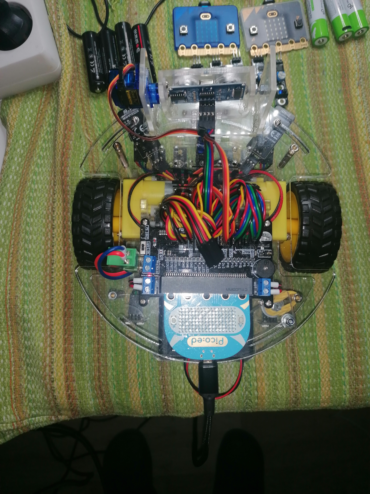
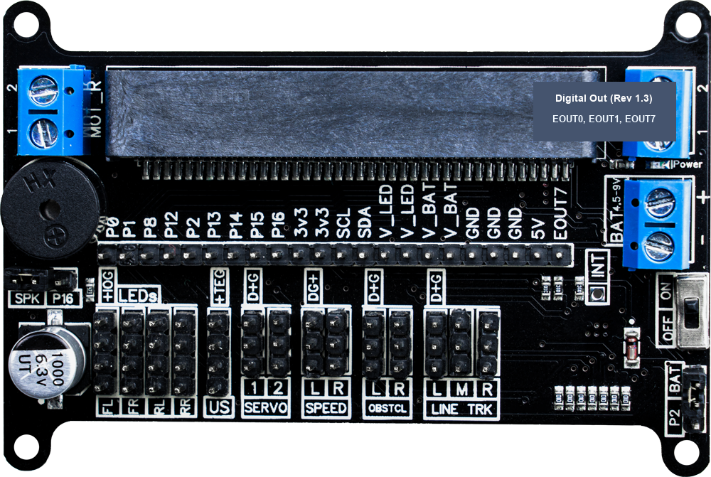

# Návody pro studenty – Základy stavby a programování robotů

Vítejte v kurzu **Základy stavby a programování robotů**!  
Tento repozitář obsahuje ucelené návody krok za krokem pro přípravu vývojového prostředí, práci s hardwarem a odevzdávání úkolů kurzu.

---

## 🤖 Používaný hardware v kurzu

Během kurzu budete pracovat se **stavebnicí JoyCar** a **dvěma procesorovými deskami**.

### 🚗 Co je to JoyCar a k čemu slouží?

**JoyCar** je modulární vzdělávací robotická stavebnice na kolovém podvozku navržená pro praktickou výuku robotiky, mechatroniky a autonomních systémů. Představuje ideální most mezi softwarovým programováním a reálným fyzickým světem:

- **Mechanická konstrukce:** Dvoukolový podvozek s nezávislým pohonem levého a pravého kola pomocí stejnosměrných motorů s převodovkou a předním opěrným kuličkovým kolečkem (tzv. diferenciální řízení podvozku).
- **Bohatá senzorická výbava:**
  - **Sledování čáry (Line Tracking):** 3 infračervené optické senzory na spodní straně podvozku pro detekci černé vodící linie na světlém podkladu.
  - **Detekce překážek:** 2 přední infračervené senzory přiblížení a **ultrazvukový dálkoměr** (na pohyblivém držáku) pro měření vzdálenosti v centimetrech.
  - **Měření rychlosti a ujeté dráhy (Odometrie):** Rychlostní senzory s perforovanými kotouči (enkodéry) na hřídelích obou motorů.
- **Akční členy a signalizace:**
  - Výkonové řízení obou stejnosměrných motorů přes integrovaný I²C budič (obvod PCA9633).
  - Adresovatelné RGB LED diody (NeoPixel / WS2812B) vpředu i vzadu pro blinkry, brzdová světla a světlomety.
  - Piezoelektrický bzučák pro akustickou signalizaci a přehrávání tónů.
- **Rozšiřitelnost:** Hlavní sběrnice I²C s expandérem PCF8574, který nabízí volné piny pro připojení dalších periferií (jak si ukážeme v kapitole o rozšíření na 6 senzorů čáry, LCD displej či externí H-můstek).

#### 🎯 K čemu JoyCar v kurzu slouží:
1. **Autonomní navigace a jízda po čáře:** Vývoj algoritmů od základního binárního přepínání přes plynulou regulaci (P a PID regulace) až po spolehlivou detekci složitých křižovatek a odboček.
2. **Bezkolizní pohyb a vyhýbání se překážkám:** Reakce na statické i pohybující se překážky v reálném čase.
3. **Odometrie a kinematika robota:** Odměřování ujeté vzdálenosti, otáčení o zadané úhly a výpočet pozice v prostoru.
4. **Reálný neblokující multitasking:** Naučíte se psát kód, který zvládá současně řídit motory, číst desítky senzorů za sekundu, blikat LED pásky a hrát melodie bez použití zhoubného `time.sleep()`.

---

### 🧠 Dvě procesorové desky

1. **Pico:ed v2 (s procesorem Raspberry Pi RP2040)** *(Hlavní platforma kurzu)*
   - Deska s výkonným dvoujádrovým procesorem RP2040 (ARM Cortex-M0+ na 133 MHz), na které běží **CircuitPython** (verze 9 nebo vyšší).
   - K počítači se připojuje jako USB disk s názvem **`CIRCUITPY`**, což umožňuje okamžité nahrávání a editaci kódu.
   - Obsahuje vestavěný maticový LED displej 7×17, dvě tlačítka, stavovou neopixel LED a piezobzučák.
   - V této desce probíhá drtivá většina praktických úkolů kurzu s robotem JoyCar. Vývoj probíhá ve **Visual Studio Code**.

2. **BBC micro:bit v2** *(Úvodní srovnávací platforma)*
   - Populární výuková deska s procesorem Nordic nRF52833, na které běží **MicroPython**.
   - Slouží na začátku kurzu pro demonstraci rozdílů v architektuře mezi MicroPythonem a CircuitPythonem.
   - Pro začátek s micro:bitem používáme jednoduchý **Mu Editor**, pokročilí mohou využít připravené prostředí přímo ve **VS Code**.

---

## 📦 Vybavení pro kurz

### 🎁 Co dostanete (vzdělávací sada od R_D):
- ✅ **Vzdělávací robotická stavebnice JoyCar** (kompletní podvozek, senzory čáry, ultrazvukový dálkoměr, senzory překážek, enkodéry rychlosti, bzučák a NeoPixel LED).
- ✅ **Procesorová deska Pico:ed v2** (s mikrokontrolérem Raspberry Pi RP2040).
- ✅ **4 ks USB nabíjecích baterií** (speciální akumulátory s vestavěným měničem, které drží stabilní napětí 1,5 V po celou dobu až do vypnutí).

### 🛠️ Co si musíte zajistit sami:
- ☐ **Počítač** s volným USB portem (Windows, macOS nebo Linux).
- ☐ **Micro USB kabel** pro připojení desky Pico:ed k počítači.
- ☐ **Testovací mapu/dráhu pro jízdu po čáře**:
  - *Nejlevnější řešení:* černá elektroinstalační páska šířky 15 mm na světlou podlahu nebo karton.
  - *Lepší řešení:* vytisknout čtvercové dlaždice na A4 a poskládat z nich dráhu.
  - *Předlohy pro velkoformátový tisk:* hotové PDF podklady pro formáty A1 nebo A3.

> [!TIP]
> Tipy na praktické doplňky (magnetický USB kabel proti poškození konektoru, záložní napájení, podrobný návod jak vyrobit srolovatelnou dráhu na linoleu a odkazy na PDF mapy) najdete v rozšiřující kapitole **[6. Praktické tipy, mapy a vylepšení výbavy](6-tipy-vybaveni-a-mapy.md)**.

---

## 📚 Rozcestník návodů

Postupujte podle jednotlivých kapitol v uvedeném pořadí:

| Kapitola | Název návodu | Popis |
|---|---|---|
| **Krok 1** | [1. Instalace a nastavení Visual Studio Code](1-instalace-vscode.md) | Stažení VS Code, automatická instalace rozšíření i nástrojů skriptem `setup.bat` a příprava pracovní složky. |
| **Krok 2** | [2. Práce s Pico:ed a CircuitPythonem](2-nastaveni-picoed.md) | Kontrola a upgrade firmware, automatické nahrávání kódu při uložení (`Run on Save` / `copy.ps1`), offline simulace (`_fake`), sériová konzole (REPL) a řešení potíží. |
| **Doplněk** | [3. Úvodní práce s Micro:bitem a MicroPythonem](3-microbit-a-micropython.md) | Úvodní srovnání s MicroPythonem: jednoduchý Mu Editor nebo pokročilé prostředí přímo ve VS Code s rozšířením MicroPython Panel a knihovnou `picoed_v2_lib`. |
| **Krok 3** | [4. Práce s Git a GitHubem (Odevzdávání úkolů)](4-prace-s-gitem.md) | Vytvoření forku, klonování, spuštění `setup.bat`, správa větví a **vytváření čistých Pull Requestů bez míchání starých úkolů**. |
| **Krok 4** | [5. Ovládání motorů robota JoyCar](5-ovladani-motoru.md) | **Kriticky důležitá kapitola:** princip budiče PCA9633, bezpečný kód pro motory, prevence spálení můstku a náhradní řešení přes PCA9685. |
| **Tipy (nepovinné)** | [6. Praktické tipy, mapy a vylepšení výbavy](6-tipy-vybaveni-a-mapy.md) | Magnetický USB kabel, tipy pro napájení, srolovatelná mapa na lino, hack I2C expandéru a rozšíření na 6 senzorů čáry. |

---

## ⚠️ Důležitá pravidla pro práci v kurzu

1. **Kód robota nespouštíme na počítači!**  
   Veškerý běžný kód pro robota běží přímo na mikrokontroléru Pico:ed (případně micro:bit). Na svém počítači nespouštíte kód přímo na fyzickém hardwaru (výjimkou je offline testování s využitím simulace `_fake/` a unit testy, které budeme probírat v pokročilejší části kurzu – viz metodický návod [Jak se testuje embedded kód](https://github.com/JanChaloupek/pomucky/blob/main/testovani-embedded-kodu.md)).
2. **Přísný zákaz blokujícího `time.sleep()` v robotických úlohách!**  
   Autonomní robot musí neustále sledovat senzory čáry a reagovat na překážky. Pokud v programu použijete `time.sleep()`, robot „oslepne“ a havaruje. Všechny časové úlohy řešíme neblokujícími časovači `Timer` a `Period`.
3. **Přísný zákaz okamžité změny směru motorů (zákaz oficiálních kódů výrobce)!**  
   Okamžité přepnutí směru (např. z jízdy vpřed rovnou na zpátečku) vytvoří proudovou špičku a indukované napětí, které **může snadno zničit H-můstek na základní desce** robota. Vždy musíte nejprve nastavit PWM na 0 a nechat motor alespoň krátký okamžik doběhnout.
4. **Odevzdávání pouze přes Pull Requesty!**  
   Každý úkol kurzu se odevzdává jako samostatný Pull Request ze samostatné větve založené z čerstvého `main`. Název Pull Requestu musí být ve formátu **`<Jméno> <Příjmení> <duXX>`** (např. `Jan Chaloupek du5`) a jméno musí přesně odpovídat vašemu účtu v Google Classroom a na Discordu.

---

## 💬 Komunikace v kurzu a sjednocení účtů (Discord, Classroom, Zoom)

Hlavním komunikačním kanálem kurzu je **Discord server kurzu**, online výuka probíhá přes **Zoom** a odevzdávání a bodové hodnocení úkolů se eviduje v **Google Classroom**.

Abychom dokázali správně spárovat vaše odevzdané úkoly a udělit vám body, **musíte na všech platformách vystupovat pod stejným jménem a příjmením**.

> [!IMPORTANT]
> **Prosím, nastavte si na našem Discord serveru viditelné jméno stejné jako v Google Classroom.**  
> Tím spárujeme váš Discord účet s účtem v Classroom, kde dostáváte body za domácí úkoly. Pokud budete stejné jméno používat i v aplikaci Zoom, velmi nám to usnadní orientaci při výuce a podpoře.

### 🔧 Jak změnit zobrazované jméno na tomto Discord serveru:
1. Klikněte / klepněte na svou profilovou ikonu:
   - na PC vlevo dole,
   - na mobilu vpravo dole.
2. Vyberte **Upravit profil** (*Edit Profile*).
3. Přejděte z hlavního profilu na záložku **Profily na serverech** (*Server Profiles*).
4. V seznamu vyberte server **„Základy stavby a programování robotů“**.
5. Do pole **Přezdívka serveru** (*Server Nickname*) vyplňte své **Jméno a Příjmení z Google Classroom**.
6. Uložte změny.

### 📝 Úvodní úkol: „Přihlášení na discord“
Jakmile máte na Discordu nastavené správné jméno:
- V příslušném kanálu kurzu na Discordu napište zprávu, abyste odevzdali úkol **„Přihlášení na discord“** 🙂.
- Vyučující vám podle jména zaeviduje splnění úkolu v Google Classroom.
