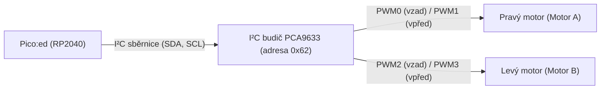
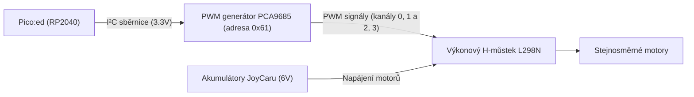

# 5. Ovládání motorů robota JoyCar (originální PCA9633 a náhrada PCA9685)

Tato kapitola se věnuje nejdůležitějšímu akčnímu členu robota: **stejnosměrným motorům podvozku**. Dozvíte se, jak je řízení motorů na JoyCaru technicky zapojeno, jak s nimi správně pracovat a jak předejít jejich zničení.

---

> [!CAUTION]
> ### 🚨 ŽIVOTNĚ DŮLEŽITÉ VAROVÁNÍ: OCHRANA MOTOROVÉHO MŮSTKU!
> 
> **Podvozek JoyCar je konstrukčně hračka, nikoliv robustní průmyslový robot.**
> 
> 1. **PŘÍSNÝ ZÁKAZ OKAMŽITÉ ZMĚNY SMĚRU OTÁČENÍ MOTORU:**  
>    Pokud motor točí dopředu a váš program **okamžitě přepne směr na zpátečku** (nebo naopak), vznikne v obvodu obrovská proudová špička v kombinaci s protisměrným indukovaným napětím (Back-EMF).  
>    **Tento jev může snadno zničit (spálit) motorový budič na základní desce!**  
>    *(K této závadě došlo bohužel v každém dosavadním ročníku kurzu u studentů, kteří toto pravidlo nerespektovali.)*
> 
> 2. **PRAVIDLO POVINNÉHO PŘECHODU PŘES NULU:**  
>    Před jakoukoliv změnou směru otáčení musíte **vždy nejprve motory úplně vypnout (nastavit PWM na 0)** a nechat je alespoň malý okamžik doběhnout (pomocí neblokujícího časovače), teprve poté sepnout opačný směr!
> 
> 3. **ZÁKAZ SPUŠTĚNÍ OFICIÁLNÍCH KÓDŮ OD VÝROBCE (Joy-IT / Joy-Car):**  
>    Některé oficiální ukázkové skripty a knihovny dodávané výrobcem Joy-Caru tuto ochranu nemají a přepínají směry natvrdo. **Nespouštějte tyto oficiální kódy na vašem robotovi!** Hrozí okamžité odpálení čipu a vyřazení robota z provozu na několik týdnů.  
>    V našem kurzu budeme striktně používat naši vlastní, bezpečnou třídu motorů.

---

## 1. Jak JoyCar motory ve skutečnosti řídí (obvod PCA9633)

Na základní desce JoyCaru nenajdete klasický můstek řízený přímo PWM piny procesoru. Výrobce zvolil netradiční zapojení: jako budič motorů použil **čtyřkanálový I²C LED driver PCA9633**.

Místo stmívání LED diod jsou však výstupy tohoto čipu připojeny na báze spínacích tranzistorů motorů. Čip tedy neřídí jas světel, ale **napětí pro jednotlivé směry motorů**.



### I²C Adresování PCA9633:
- **Výchozí hardwarová adresa:** `0x62` (u starších revizí JoyCaru `0x60`).
- **Univerzální broadcast adresa:** `0x70` (registr `ALLCALLADR` – na tuto adresu reagují všechny čipy PCA9633 současně; v některých návodech je chybně uváděna jako jediná adresa).

### Struktura I²C komunikace:
Komunikace probíhá vždy zápisem **dvou bajtů**:
1. **Control byte** – určuje číslo cílového registru.
2. **Data byte** – zapisovaná hodnota registru.

### Klíčové registry PCA9633:

| Registr | Název | Význam pro řízení motorů |
|---|---|---|
| `0x00` | **MODE1** | Řízení spánku a podadres. Hodnota `0x00` probudí čip ze spánku. Probuzení interního oscilátoru trvá cca 500 µs (v kódu čekáme 2 ms). |
| `0x08` | **LEDOUT** | Režim výstupů. Výchozí hodnota po resetu motory netočí. Zápisem hodnoty `0xAA` přepneme všechny 4 výstupy do individuálního PWM režimu řízeného registry `PWM0`–`PWM3`. |
| `0x02` | **PWM0** | Výkon pro motor A (pravý) – **směr VZAD** (hodnota 0–255). |
| `0x03` | **PWM1** | Výkon pro motor A (pravý) – **směr VPŘED** (hodnota 0–255). |
| `0x04` | **PWM2** | Výkon pro motor B (levý) – **směr VZAD** (hodnota 0–255). |
| `0x05` | **PWM3** | Výkon pro motor B (levý) – **směr VPŘED** (hodnota 0–255). |

---

## 2. Bezpečná objektová třída pro CircuitPython

Zde je ukázka bezpečné implementace třídy `JoyCarMotors` v CircuitPythonu, která **automaticky ošetřuje přechod přes nulu** a chrání můstek před zničením:

```python
import time
from busio import I2C

class SafeJoyCarMotors:
    """Bezpečný ovladač motorů JoyCar přes I2C obvod PCA9633."""
    
    REG_MODE1 = 0x00
    REG_LEDOUT = 0x08
    REG_PWM0 = 0x02  # Motor A vzad
    REG_PWM1 = 0x03  # Motor A vpřed
    REG_PWM2 = 0x04  # Motor B vzad
    REG_PWM3 = 0x05  # Motor B vpřed

    def __init__(self, i2c: I2C, address: int = 0x62):
        self._i2c = i2c
        self._address = address
        self._current_speed_a = 0
        self._current_speed_b = 0
        
        self._init_chip()

    def _write_reg(self, reg: int, val: int) -> None:
        """Zapíše control byte a hodnotu do registru."""
        while not self._i2c.try_lock():
            pass
        try:
            self._i2c.writeto(self._address, bytes([reg, val & 0xFF]))
        finally:
            self._i2c.unlock()

    def _init_chip(self) -> None:
        """Inicializace PCA9633: probuzení a zapnutí PWM na všech 4 výstupech."""
        self._write_reg(self.REG_MODE1, 0x00)  # Probudit ze sleepu
        time.sleep(0.002)                      # Nutná prodleva min. 500 us pro stabilizaci oscilátoru
        self._write_reg(self.REG_LEDOUT, 0xAA) # Nastavit všechny 4 kanály do PWM módu
        self.stop()

    def set_motor_a(self, speed: int) -> None:
        """
        Nastaví rychlost pravého motoru (-255 až +255).
        Záporné hodnoty = vzad, kladné = vpřed, 0 = stop.
        """
        speed = max(-255, min(255, speed))
        
        # BEZPEČNOSTNÍ POJISTKA: Detekce okamžité reverzace směru!
        if (self._current_speed_a > 0 and speed < 0) or (self._current_speed_a < 0 and speed > 0):
            # Nejprve natvrdo vypneme oba směry
            self._write_reg(self.REG_PWM0, 0)
            self._write_reg(self.REG_PWM1, 0)
            time.sleep(0.01)  # Krátká 10ms bezpečnostní prodleva pro doběhnutí rotoru
            
        self._current_speed_a = speed

        if speed > 0:
            self._write_reg(self.REG_PWM0, 0)      # Vypnout vzad
            self._write_reg(self.REG_PWM1, speed)  # Sepnout vpřed
        elif speed < 0:
            self._write_reg(self.REG_PWM1, 0)      # Vypnout vpřed
            self._write_reg(self.REG_PWM0, -speed) # Sepnout vzad
        else:
            self._write_reg(self.REG_PWM0, 0)
            self._write_reg(self.REG_PWM1, 0)

    def set_motor_b(self, speed: int) -> None:
        """
        Nastaví rychlost levého motoru (-255 až +255).
        Záporné hodnoty = vzad, kladné = vpřed, 0 = stop.
        """
        speed = max(-255, min(255, speed))
        
        # BEZPEČNOSTNÍ POJISTKA: Detekce okamžité reverzace směru!
        if (self._current_speed_b > 0 and speed < 0) or (self._current_speed_b < 0 and speed > 0):
            self._write_reg(self.REG_PWM2, 0)
            self._write_reg(self.REG_PWM3, 0)
            time.sleep(0.01)
            
        self._current_speed_b = speed

        if speed > 0:
            self._write_reg(self.REG_PWM2, 0)
            self._write_reg(self.REG_PWM3, speed)
        elif speed < 0:
            self._write_reg(self.REG_PWM3, 0)
            self._write_reg(self.REG_PWM2, -speed)
        else:
            self._write_reg(self.REG_PWM2, 0)
            self._write_reg(self.REG_PWM3, 0)

    def stop(self) -> None:
        """Bezpečně zastaví oba motory."""
        self.set_motor_a(0)
        self.set_motor_b(0)
```

---

## 3. Záchrana při spálení můstku (Náhrada přes PCA9685 + L298N)

Pokud k odpálení původního čipu PCA9633 přece jen dojde, nemusíte čekat týdny na reklamaci základní desky robota. JoyCar lze plně oživit pomocí dvou běžně dostupných modulů:

1. **PCA9685 (I²C 16kanálový 12bitový PWM generátor):**
   - Vytváří precizní PWM signál s rozlišením 12 bitů (hodnoty 0–4095).
   - Výchozí hardwarová I²C adresa bývá `0x40` nebo `0x61`.
2. **L298N (nebo DRV8833 – duální H-můstek):**
   - Zajišťuje výkonové spínání motorů přímo z baterií robota.
   - Snese proud až 2 A na kanál, takže se nepřehřívá ani při zablokování kol.



### Ovladač pro PCA9685 v CircuitPythonu:

V našem repozitáři [PCA9685](https://github.com/JanChaloupek/PCA9685) najdete kompletní driver. Klíčová metoda pro buzení H-můstku:

```python
class PCA9685:
    RegMODE1 = 0x00
    RegPwm00 = 0x06  # Registry pro kanál 0 (On_L, On_H, Off_L, Off_H)

    def __init__(self, i2c, address=0x61):
        self._i2c = i2c
        self._address = address

    def savePwm(self, value: int) -> tuple[int, int]:
        """Přepočte 12bitovou hodnotu (0–4095) na On a Off registry."""
        if value >= 4095:
            return 4096, 0  # Trvalá 1
        elif value <= 0:
            return 0, 4096  # Trvalá 0
        else:
            return 0, value

    def writePwmToHbridge(self, channel: int, speed: int) -> None:
        """
        Řídí dvojici PWM kanálů můstku (channel a channel+1).
        speed v rozsahu -4095 až +4095.
        Kladná hodnota = vpřed, záporná hodnota = vzad.
        """
        if speed > 0:
            val_on0, val_off0 = self.savePwm(speed)
            val_on1, val_off1 = self.savePwm(0)
        else:
            val_on0, val_off0 = self.savePwm(0)
            val_on1, val_off1 = self.savePwm(-speed)

        # Rychlý zápis všech 8 bajtů obou kanálů najednou
        data = bytearray([
            channel * 4 + self.RegPwm00,
            val_on0 & 0xFF, val_on0 >> 8, val_off0 & 0xFF, val_off0 >> 8,
            val_on1 & 0xFF, val_on1 >> 8, val_off1 & 0xFF, val_off1 >> 8,
        ])
        while not self._i2c.try_lock():
            pass
        try:
            self._i2c.writeto(self._address, data)
        finally:
            self._i2c.unlock()
```

---

## 4. Tuning motorů: Kovové převody a dvoukanálové enkodéry

Pokud chcete posunout jízdní vlastnosti JoyCaru na špičkovou úroveň, lze originální žluté plastové motory nahradit profesionálními motory **[DFRobot FIT01458](https://www.dfrobot.com/product-1458.html)**:

| Vlastnost | Původní motor JoyCar | DFRobot FIT01458 (Tuning) |
|---|---|---|
| **Výstupní hřídel** | Plastová (snadno se strhne) | **Kovová D-osa** (vysoká odolnost) |
| **Převodovka** | Plastová ozubená kola | **Kovová soukolí** |
| **Měření otáček** | Jednokanálový optický enkodér (pouze rychlost, nepozná směr) | **Dvoukanálový impulzér s fázovým posunem** (rozpozná rychlost i přesný směr otáčení) |
| **Proud naprázdno (6 V)** | cca 120 mA | cca **250 mA** |
| **Proud v zátěži (6 V)** | cca 250 mA | **přes 500 mA** |

> [!WARNING]
> ### Pozor na proudové limity a mechanické rozměry!
> 1. **Nepřipojujte motory FIT01458 přímo na původní desku JoyCaru!** Zvýšený proudový odběr (přes 500 mA na motor) by původní obvod PCA9633 okamžitě zničil. Tyto motory provozujte výhradně přes externí modul (např. rozšiřující desku **Elecfreaks motor:bit** nebo H-můstek L298N).
> 2. **Mechanická úprava podvozku:** Ačkoliv má motor shodné rozteče montážních šroubků, kvůli přidané desce elektroniky enkodéru je tělo motoru o něco delší. Do spodního akrylátového šasi je nutné vyvrtat/vypilovat montážní otvor, aby se motor do podvozku vešel.

---

## 5. Shrnutí pravidel pro práci s motory v kurzu

1. **Vždy startujte z nuly:** Před rozjezdem i při brzdění měňte rychlost plynule.
2. **Přechod přes nulu při změně směru:** Mezi jízdou vpřed a vzad zařaďte povinné zastavení a krátkou prodlevu.
3. **Nepoužívejte oficiální kód výrobce:** Používejte zásadně naši bezpečnou třídu.
4. **V případě závady nezoufejte:** Spálený můstek lze levně a rychle nahradit kombinací modulů PCA9685 a L298N.

---

### Kam pokračovat dál?

- **Vylepšení hardwaru, mapy na lino a rozšíření na 6 senzorů čáry:**  
  👉 **[6. Praktické tipy, mapy a vylepšení výbavy](tipy-vybaveni-a-mapy.md)**
- **Zpět na rozcestník všech návodů:**  
  👉 **[Hlavní přehled kurzu](README.md)**
